## 研究背景
优势在于，大批量的去扫明场，可以自己去选定视野

## 实验操作
1. 制片：
	1.  样品信息：猕猴睪丸  
	2. 1抗信息  
		1. UTF-1  
			1. 1:1000  
			2. MAB4337，Millipore；克隆 **5G10.2**  
			3. 小鼠单克隆抗体；IgG1κ；纯化腹水  
			4. 有猕猴使用证据  
		2. c-KIT   
			1. 1:200  
			2. ab32363，Abcam；克隆 **YR145**  
			3. 兔重组单克隆抗体；IgG  
			4. 有猕猴使用证据  
		3. SOX9  
			1. 1:1500  
			2. AB5535（PDF另列产品编号 **633930**），Millipore/Chemicon  
			3. 兔多克隆抗体  
			4. 有猕猴使用证据  
		4. SYCP3  
			1. 1:1500  
			2. **NB300‑232**，Novus Biologicals  
			3. 兔多克隆抗体；免疫原亲和纯化；BSA‑free  
	3. 实验步骤  
		1. 石蜡切片经二甲苯脱蜡两次，每次15分钟，再依次置于无水乙醇、95%乙醇和75%乙醇中，各2分钟，随后浸入纯水。采用高压法进行抗原修复，时间为2分30秒。修复后用PBS冲洗3次，每次5分钟；滴加内源性过氧化物酶阻断剂，孵育15分钟，再用PBS冲洗3次，每次5分钟。滴加正常山羊封闭血清，孵育15分钟后，加入稀释好的一抗并过夜孵育。次日用PBS冲洗3次，每次10分钟，滴加二抗孵育15分钟，再用PBS冲洗3次，每次10分钟。随后进行DAB显色，并用PBS冲洗。切片以苏木素复染3分钟，经流水冲洗2分钟后，用盐酸酒精分化10秒，再流水冲洗2分钟，并于热水中反蓝5分钟。最后依次置于75%乙醇、95%乙醇和无水乙醇中脱水，各2分钟；待玻片晾干后，以中性树胶封片。
2. 扫片
	1. 打开软件VS200 ASW  
	2. 点击左下角更换托盘，取出托盘，将IHC玻片按照正确的上下顺序放入，然后使用酒精+擦镜纸轻轻擦去玻片上的灰尘  
	3. 单独扫描  
		1. 点击第一个片子，右下点击开始扫描，完成后得到预览结果  
		2. 左上角点击扫描区域，删除当前的框（选中+Delete），选择多边形扫描区域类型，然后将目标区域圈起来  
		3. 重点检查样品区域，并不是每一次初扫都能将样品的完整区域标出来，需要自己覆盖想要的区域  
		4. 检查多点聚焦，聚焦点自动计算的，保证分布均匀即可，一般不需要调，聚焦点越多，时间越长（以上3步都影响单片扫描时间）  
			1. 另外一提，需要仔细确认聚焦点覆盖了扫描区域和样品区域  
		5. 左上角切到画廊，右侧命名与保存，切到目标结果文件夹  
		6. 右侧载玻片属性，更改切片名称（请注意，后续更改文件夹有概率导致文件直接损伤）  
		7. 右侧切详细信息  
			1. 看目标倍率，倍率越高时间越长，内存越大，明场选择40X即可  
			2. Z平面不需要过于注意，普通即可  
		8. 聚焦  
			1. 和之前聚焦点选择相关，聚焦点普通即可，其余保持默认  
		9. 开始扫描  
		10. 完成后右下角保存并新建扫描，然后重复3  
	4. 批处理扫描  
		1. 批处理，shift全选想扫预览的玻片，然后右侧选择病理室，确认玻片下方都变成病理室以后，点击右下角开始扫描  
		2. 扫描完成后逐个完成扫描区域和多点聚焦选择  
		3. 左上角点击画廊，对于每个玻片，右侧单独配置保存的文件夹和玻片名  
		4. 对于每个玻片确认详细信息与聚焦  
		5. 点开始扫描
3. 后续处理：
	1. 每个抗体中，每个样本选择5个视野，一共20个视野，10个对照10个暴露  
	2. 分离棕色 DAB 信号  
		1. 在 Fiji 运行 **v3 ROI 筛选脚本**：File → New → Script → File  → Open脚本  → Run  
			1. 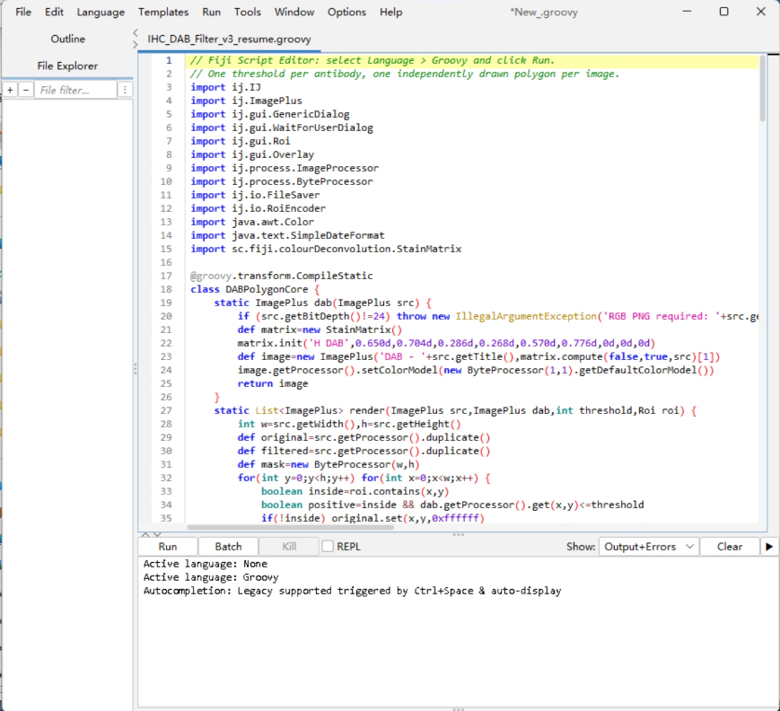  
			2. 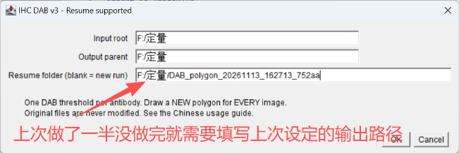  
			3. 选择抗体名，选择预览图片，开始进行阈值定位
				1. 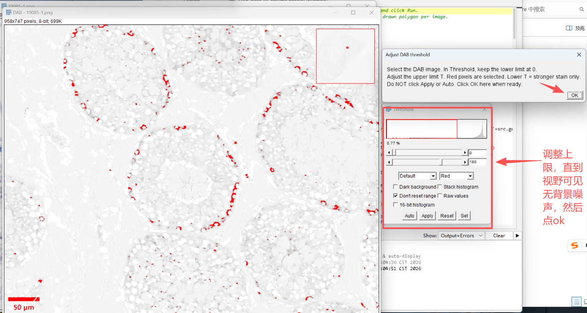
				2. 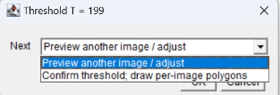
				3. 继续看其他图来调整阈值选第一个，确定完阈值选第二个
		2. 原理  
			1. 使用 **H DAB 色彩分离**，将棕色 DAB 与蓝色复染分开。  
			2. 提取第 2 通道，即 DAB 通道，并用灰度显示。  
			3. **深棕色对应较低灰度，浅棕色对应较高灰度**，因此保留范围设为 **0–T**。  
			4. 这一步是筛选染色像素，尚未得到细胞数。  
			5. 选择同一抗体的多张代表图片，结合原图、阴性区域和阴性对照调整阈值。
				1. 降低 T：筛选更严格，排除更多浅染色。
				2. 提高 T：保留更多弱染色，也可能增加背景。
			6. **同一抗体的对照组与实验组使用相同阈值**，确定后固定，不按组别分别调整。  
		3. 本次保存的阈值（DAB 灰度保留范围）为：
			1. | ckit  | 0–208 |
			2. | SOX9  | 0–147 |
			3. | SYCP3 | 0–140 |
			4. | UTF1  | 0–200 |
	4. 每张图片独立画多边形 ROI  
		1. 在每张原图上沿目标小管边界绘制多边形，双击结束。  
			1. 每张图独立画 ROI，不套用其他图片的区域。
				1. 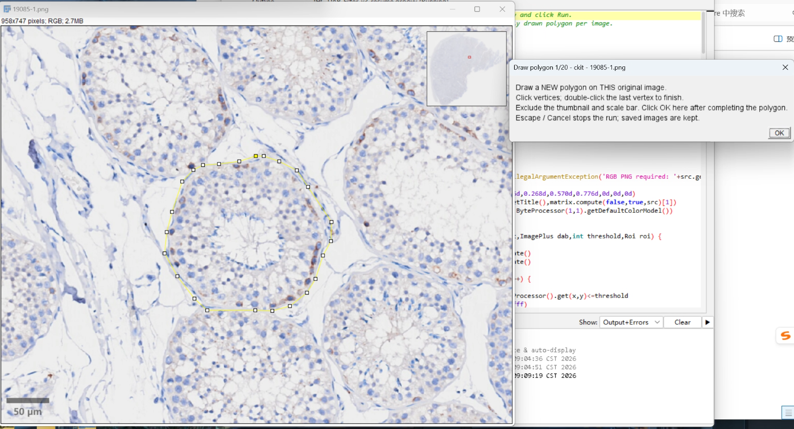
			2. 排除其他小管、缩略图、比例尺和无关组织。  
			3. 统一是否包含管腔、边缘细胞等规则。  
			4. 对照预览检查，必要时重画，再保存。  
		2. 逐个完成图片  
			1. 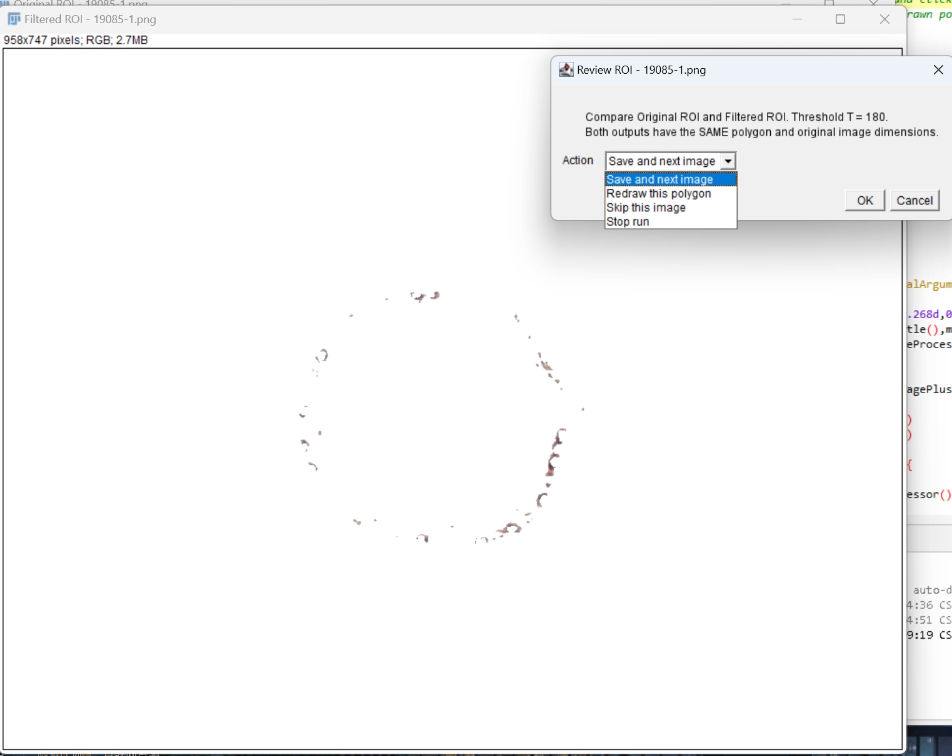  
	5. v3预处理脚本结果  
		1. 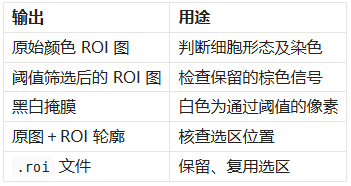  
		2. 中断后用 v3 的续做功能，沿用原阈值并跳过已保存图片  
	6. 双图对照，人工打点计数  
		1. 运行 **v3 后续细胞计数脚本**，选择对应上一步预处理结果目录  
			1. 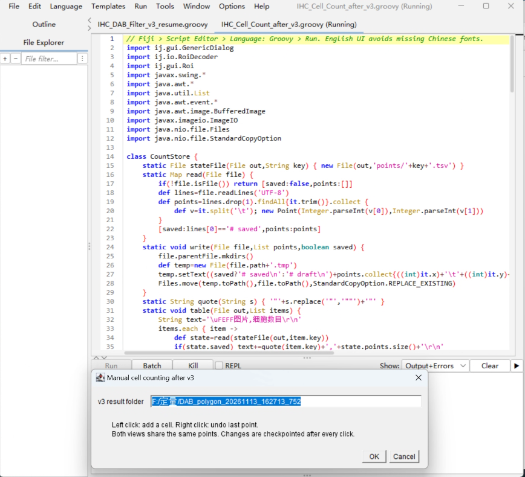  
		2. 左侧显示黑白掩膜，右侧显示原始颜色 ROI  
			1. 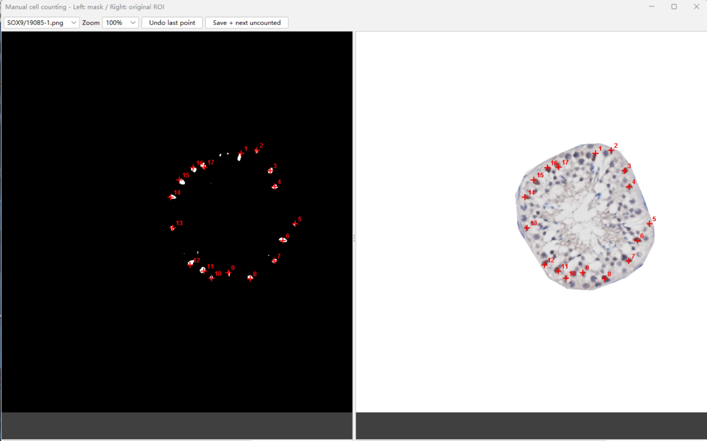  
		3. **左键：添加一个细胞标记**，两张图同步显示编号  
		4. **右键：撤销最近一个点**  
		5. 一个点对应一个确认的细胞  
		6. 每张完成后点击 **Save + next uncounted**；没有细胞也要保存，记录为 **0**。点位自动保存，可中断续做。  
			1. 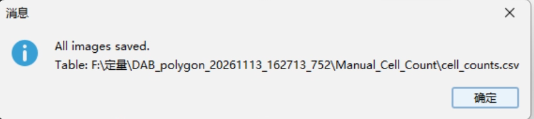  
		7. 核对并导出计数，最终 `cell_counts.csv` 为两列：**图片、细胞数目**  
			1. 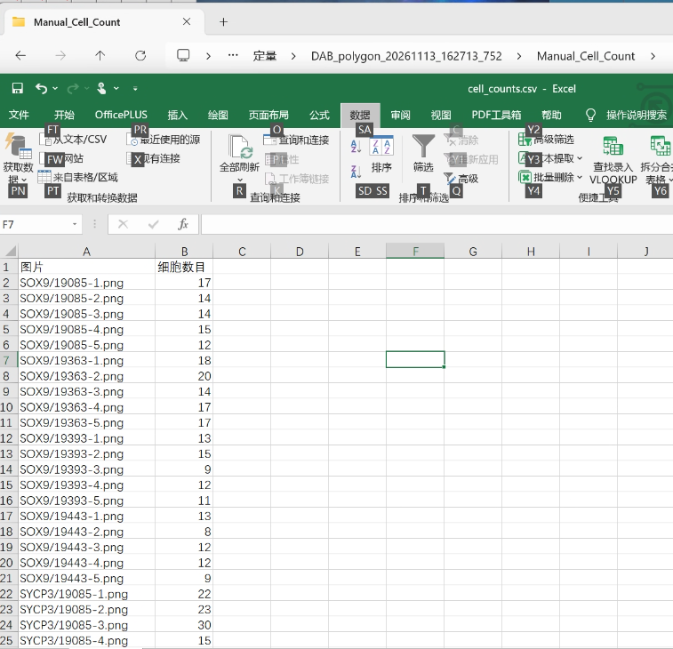  
	7. 比较定量  
		1. 每个抗体分别比较 **10 个对照小管 vs 10 个实验小管**  
		2. 使用原始细胞数做**双侧、非配对、等方差 Student t 检验**  
		3. 图时，以对应抗体的对照组平均数归一化，使对照均值为 1  
		4. 柱形表示均值，误差线表示小管间 SEM，黑色散点代表每个小管，图上标注 p 值  
		5. 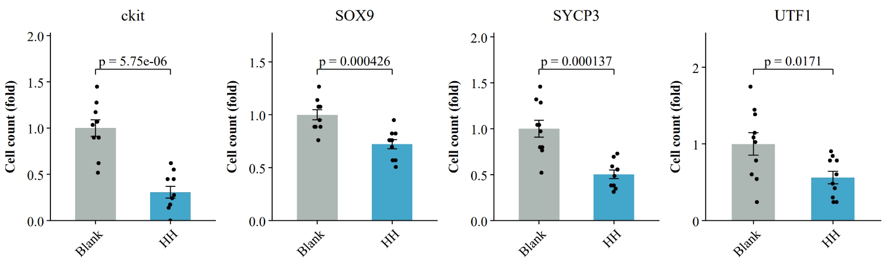  
			1. 字体不是Arial得自己调  
	8. AI制作  
		1. 图片处理  
			1. 首先将原图置入，然后等比例缩放到20mm高，右键裁剪图像1，裁剪的长宽为15mm的正方形  
			2. 放大图
					1. 将原图缩放到60mm高，截取15mm方框
					2. 绘制黑框，填色无，描边白0.5pt，3mm方框
					3. 插入虚线，填色无，描边白0.5pt，虚线首个框2pt
			3. 文字
				1. 字体Arial，抗体7pt，其他6pt，p值改成斜体
				2. 抗体颜色深棕色 `#70452D`，其他均为黑色
			4. 比例尺
				1. 原图比例尺为50mm，放大图为50/6mm
		2. 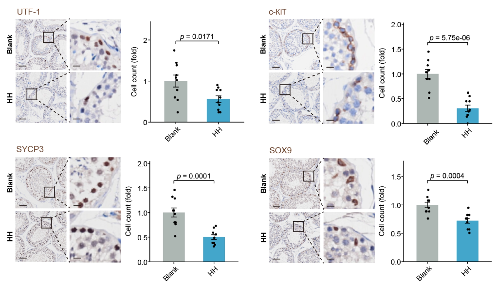
## 实验结果与分析
全细胞类型显著差异，整体流程符合科学规则

## 个人理解
也算是赶工出来了，Fiji真是个好东西


关键脚本如下：
```groovy
# IHC_DAB_Filter_v3_resume.groovy

// Fiji Script Editor: select Language > Groovy and click Run.
// One threshold per antibody, one independently drawn polygon per image.
import ij.IJ
import ij.ImagePlus
import ij.gui.GenericDialog
import ij.gui.WaitForUserDialog
import ij.gui.Roi
import ij.gui.Overlay
import ij.process.ImageProcessor
import ij.process.ByteProcessor
import ij.io.FileSaver
import ij.io.RoiEncoder
import java.awt.Color
import java.text.SimpleDateFormat
import sc.fiji.colourDeconvolution.StainMatrix

@groovy.transform.CompileStatic
class DABPolygonCore {
    static ImagePlus dab(ImagePlus src) {
        if (src.getBitDepth()!=24) throw new IllegalArgumentException('RGB PNG required: '+src.getTitle())
        def matrix=new StainMatrix()
        matrix.init('H DAB',0.650d,0.704d,0.286d,0.268d,0.570d,0.776d,0d,0d,0d)
        def image=new ImagePlus('DAB - '+src.getTitle(),matrix.compute(false,true,src)[1])
        image.getProcessor().setColorModel(new ByteProcessor(1,1).getDefaultColorModel())
        return image
    }
    static List<ImagePlus> render(ImagePlus src,ImagePlus dab,int threshold,Roi roi) {
        int w=src.getWidth(),h=src.getHeight()
        def original=src.getProcessor().duplicate()
        def filtered=src.getProcessor().duplicate()
        def mask=new ByteProcessor(w,h)
        for(int y=0;y<h;y++) for(int x=0;x<w;x++) {
            boolean inside=roi.contains(x,y)
            boolean positive=inside && dab.getProcessor().get(x,y)<=threshold
            if(!inside) original.set(x,y,0xffffff)
            if(!positive) filtered.set(x,y,0xffffff)
            mask.set(x,y,positive?255:0)
        }
        return [new ImagePlus('Original ROI - '+src.getTitle(),original),
                new ImagePlus('Filtered ROI - '+src.getTitle(),filtered),
                new ImagePlus('Mask - '+src.getTitle(),mask)]
    }
    static ImagePlus outlined(ImagePlus src,Roi roi) {
        def copy=src.duplicate()
        copy.deleteRoi()
        def line=(Roi)roi.clone()
        line.setStrokeColor(Color.RED)
        line.setStrokeWidth(2d)
        copy.setOverlay(new Overlay(line))
        def result=copy.flatten()
        copy.close()
        return result
    }
    static void close(ImagePlus image) {
        if(image!=null) { image.changes=false; image.close() }
    }
    static void save(ImagePlus image,File path) {
        if(!new FileSaver(image).saveAsPng(path.getAbsolutePath()))
            throw new IOException('Cannot save '+path)
    }
}

class DABResumeState {
    static Map thresholds(File output) {
        def result=[:]
        new File(output,'thresholds.csv').readLines('UTF-8').drop(1).each { line ->
            def match=line =~ /^"((?:[^"]|"")*)",0,(\d+)$/
            if(match.matches()) {
                int value=Integer.parseInt(match[0][2])
                if(value<0 || value>255) throw new IOException('Invalid saved threshold')
                result[match[0][1].replace('""','"')]=value
            } else if(line.trim()) throw new IOException('Cannot read threshold row: '+line)
        }
        return result
    }
    static boolean complete(File output,File input,Set completed) {
        if(!completed.contains(input.path)) return false
        def dest=new File(output,input.parentFile.name)
        def required=['original_roi','filtered_roi','original_with_roi','masks'].collect { new File(dest,it+'/'+input.name) }
        required.add(new File(dest,'rois/'+input.name.replaceFirst(/(?i)\.png$/,'.roi')))
        return required.every{it.isFile() && it.length()>0}
    }
}

if(binding.hasVariable('validationOnly') && validationOnly) return

def setup=new GenericDialog('IHC DAB v3 - Resume supported')
setup.addStringField('Input root','F:/定量',45)
setup.addStringField('Output parent','F:/定量',45)
setup.addStringField('Resume folder (blank = new run)','F:/定量/DAB_polygon_20261113_162713_752',65)
setup.addMessage('One DAB threshold per antibody. Draw a NEW polygon for EVERY image.\nOriginal files are never modified. See the Chinese usage guide.')
setup.showDialog()
if(setup.wasCanceled()) return
def root=new File(setup.getNextString())
def parent=new File(setup.getNextString())
String resumePath=setup.getNextString().trim()
boolean resuming=!resumePath.isEmpty()
if(!root.isDirectory() || !parent.isDirectory()) { IJ.error('Input root and output parent must exist.'); return }
def folders=root.listFiles().findAll { it.isDirectory() && it.listFiles().any { f->f.isFile() && f.name.toLowerCase().endsWith('.png') } }.sort{it.name.toLowerCase()}
if(!folders) { IJ.error('No antibody subfolders containing PNG files.'); return }
def output=resuming ? new File(resumePath) : new File(parent,'DAB_polygon_'+new SimpleDateFormat('yyyyMMdd_HHmmss_SSS').format(new Date()))
if(resuming) {
    if(!output.isDirectory() || !['thresholds.csv','roi_records.csv','processing_log.txt'].every{new File(output,it).isFile()}) {
        IJ.error('Resume folder must contain thresholds.csv, roi_records.csv and processing_log.txt.'); return
    }
} else if(!output.mkdirs()) { IJ.error('Cannot create output folder.'); return }
def parameters=new File(output,'thresholds.csv')
if(!resuming) parameters.setText('antibody,DAB_min,DAB_max\n','UTF-8')
def records=new File(output,'roi_records.csv')
if(!resuming) records.setText('antibody,image,width,height,roi_type,roi_pixels,positive_pixels,DAB_max\n','UTF-8')
def log=new File(output,'processing_log.txt')
if(!resuming) log.setText('H DAB channel 2. Positive: raw gray 0..T inside per-image polygon.\n','UTF-8')
def savedThresholds=DABResumeState.thresholds(output)
def completed=log.readLines('UTF-8').findAll{it.startsWith('OK ')}.collect{it.substring(3)} as Set
if(resuming) log.append('RESUME '+new Date().toString()+'\n','UTF-8')
def csv={v->'"'+v.toString().replace('"','""')+'"'}
def remaining=new ArrayList(folders.findAll { group ->
    group.listFiles().findAll{it.isFile() && it.name.toLowerCase().endsWith('.png')}.any{!DABResumeState.complete(output,it,completed)}
})
int saved=0
try {
    while(remaining) {
        def antibodyDialog=new GenericDialog('Select antibody')
        antibodyDialog.addChoice('Antibody',remaining.collect{it.name} as String[],remaining[0].name)
        antibodyDialog.showDialog()
        if(antibodyDialog.wasCanceled()) break
        String selected=antibodyDialog.getNextChoice()
        def folder=remaining.find{it.name==selected}
        def images=folder.listFiles().findAll{it.isFile() && it.name.toLowerCase().endsWith('.png')}.sort{it.name.toLowerCase()}
        int threshold=savedThresholds.containsKey(folder.name) ? (int)savedThresholds[folder.name] : 180
        String lastName=images[0].name
        boolean thresholdReady=savedThresholds.containsKey(folder.name)
        if(thresholdReady) IJ.showMessage('Resuming '+folder.name,'Using saved threshold T = '+threshold+'.\nCompleted images will be skipped. Draw polygons for the remaining images.')
        while(!thresholdReady) {
            def previewDialog=new GenericDialog('Threshold preview - '+folder.name)
            previewDialog.addChoice('Preview image',images.collect{it.name} as String[],lastName)
            previewDialog.addMessage('Preview any number of images before confirming the antibody threshold.')
            previewDialog.showDialog()
            if(previewDialog.wasCanceled()) throw new InterruptedException('Canceled during threshold selection')
            lastName=previewDialog.getNextChoice()
            def src=null,dab=null
            try {
                src=IJ.openImage(new File(folder,lastName).path)
                if(src==null) throw new IOException('Cannot open '+lastName)
                src.show()
                dab=DABPolygonCore.dab(src); dab.show()
                dab.getProcessor().setThreshold(0,threshold,ImageProcessor.RED_LUT)
                dab.updateAndDraw()
                IJ.run(dab,'Threshold...','')
                def wait=new WaitForUserDialog('Adjust DAB threshold',
                    'Select the DAB image. In Threshold, keep the lower limit at 0.\nAdjust the upper limit T. Red pixels are selected. Lower T = stronger stain only.\nDo NOT click Apply or Auto. Click OK here when ready.')
                wait.show()
                if(wait.escPressed()) throw new InterruptedException('Canceled during threshold selection')
                double low=dab.getProcessor().getMinThreshold(),high=dab.getProcessor().getMaxThreshold()
                if(low!=0 || high<0 || high>255) throw new IllegalArgumentException('Keep threshold lower limit at 0; do not click Apply.')
                threshold=(int)high
                def confirm=new GenericDialog('Threshold T = '+threshold)
                confirm.addChoice('Next',['Preview another image / adjust','Confirm threshold; draw per-image polygons'] as String[],'Preview another image / adjust')
                confirm.showDialog()
                if(confirm.wasCanceled()) throw new InterruptedException('Canceled during threshold selection')
                thresholdReady=confirm.getNextChoice().startsWith('Confirm')
            } finally { DABPolygonCore.close(dab); DABPolygonCore.close(src) }
        }
        if(!savedThresholds.containsKey(folder.name)) {
            parameters.append(csv(folder.name)+',0,'+threshold+'\n','UTF-8')
            savedThresholds[folder.name]=threshold
        }
        def dest=new File(output,folder.name)
        ['original_roi','filtered_roi','original_with_roi','masks','rois'].each { new File(dest,it).mkdirs() }
        images.eachWithIndex { file,index ->
            if(DABResumeState.complete(output,file,completed)) return
            def src=null,dab=null,products=null,outline=null
            try {
                src=IJ.openImage(file.path)
                if(src==null) throw new IOException('Cannot open image')
                dab=DABPolygonCore.dab(src)
                boolean done=false
                while(!done) {
                    src.deleteRoi(); src.show(); src.getWindow().toFront()
                    IJ.setTool('polygon')
                    def wait=new WaitForUserDialog('Draw polygon '+(index+1)+'/'+images.size()+' - '+folder.name+' - '+file.name,
                        'Draw a NEW polygon on THIS original image.\nClick vertices; double-click the last vertex to finish.\nExclude the thumbnail and scale bar. Click OK here after completing the polygon.\nEscape / Cancel stops the run; saved images are kept.')
                    wait.show()
                    if(wait.escPressed()) throw new InterruptedException('Canceled while drawing ROI')
                    def selectedRoi=src.getRoi()
                    if(selectedRoi==null || !(selectedRoi.getType() in [Roi.POLYGON,Roi.FREEROI,Roi.TRACED_ROI])) {
                        IJ.showMessage('Polygon required','Please complete a polygon (or freehand area) on this image.'); continue
                    }
                    def roi=(Roi)selectedRoi.clone()
                    products=DABPolygonCore.render(src,dab,threshold,roi)
                    products[0].show(); products[1].show()
                    def review=new GenericDialog('Review ROI - '+file.name)
                    review.addMessage('Compare Original ROI and Filtered ROI. Threshold T = '+threshold+'.\nBoth outputs have the SAME polygon and original image dimensions.')
                    review.addChoice('Action',['Save and next image','Redraw this polygon','Skip this image','Stop run'] as String[],'Save and next image')
                    review.showDialog()
                    if(review.wasCanceled()) throw new InterruptedException('Canceled during ROI review')
                    def action=review.getNextChoice()
                    if(action=='Stop run') throw new InterruptedException('User stopped run')
                    if(action=='Save and next image') {
                        DABPolygonCore.save(products[0],new File(dest,'original_roi/'+file.name))
                        DABPolygonCore.save(products[1],new File(dest,'filtered_roi/'+file.name))
                        DABPolygonCore.save(products[2],new File(dest,'masks/'+file.name))
                        outline=DABPolygonCore.outlined(src,roi)
                        DABPolygonCore.save(outline,new File(dest,'original_with_roi/'+file.name))
                        new RoiEncoder(new File(dest,'rois/'+file.name.replaceFirst(/(?i)\.png$/,'.roi')).path).write(roi)
                        long inside=0,positive=0
                        for(int y=0;y<src.height;y++) for(int x=0;x<src.width;x++) {
                            if(roi.contains(x,y)) inside++
                            if(products[2].getProcessor().get(x,y)>0) positive++
                        }
                        records.append([csv(folder.name),csv(file.name),src.width,src.height,roi.getType(),inside,positive,threshold].join(',')+'\n','UTF-8')
                        log.append('OK '+file.path+'\n','UTF-8'); completed.add(file.path); saved++; done=true
                    } else if(action=='Skip this image') {
                        log.append('SKIP '+file.path+'\n','UTF-8'); done=true
                    }
                    products.each{DABPolygonCore.close(it)}; products=null
                }
            } catch(InterruptedException stop) { throw stop
            } catch(Exception failure) {
                log.append('ERROR '+file.path+' : '+failure.toString()+'\n','UTF-8')
                IJ.showMessage('Image failed',file.name+'\n'+failure.message+'\nSee processing_log.txt. Continuing with next image.')
            } finally {
                if(products!=null) products.each{DABPolygonCore.close(it)}
                DABPolygonCore.close(outline); DABPolygonCore.close(dab); DABPolygonCore.close(src)
            }
        }
        remaining.remove(folder)
    }
} catch(Exception stopped) {
    log.append('STOP '+stopped.toString()+'\n','UTF-8')
    IJ.log(stopped.toString())
}
IJ.showMessage('DAB polygon run finished','Saved '+saved+' image sets.\nOutput: '+output.path+'\nCheck processing_log.txt for skipped images, errors or cancellation.')

```

```groovy
# IHC_Cell_Count_after_v3.groovy

// Fiji > Script Editor > Language: Groovy > Run. English UI avoids missing Chinese fonts.
import ij.gui.GenericDialog
import ij.io.RoiDecoder
import ij.gui.Roi
import javax.swing.*
import java.awt.*
import java.util.List
import java.awt.event.*
import java.awt.image.BufferedImage
import javax.imageio.ImageIO
import java.nio.file.Files
import java.nio.file.StandardCopyOption

class CountStore {
    static File stateFile(File out,String key) { new File(out,'points/'+key+'.tsv') }
    static Map read(File file) {
        if(!file.isFile()) return [saved:false,points:[]]
        def lines=file.readLines('UTF-8')
        def points=lines.drop(1).findAll{it.trim()}.collect {
            def v=it.split('\t'); new Point(Integer.parseInt(v[0]),Integer.parseInt(v[1]))
        }
        [saved:lines[0]=='# saved',points:points]
    }
    static void write(File file,List points,boolean saved) {
        file.parentFile.mkdirs()
        def temp=new File(file.path+'.tmp')
        temp.setText((saved?'# saved\n':'# draft\n')+points.collect{((int)it.x)+'\t'+((int)it.y)+'\n'}.join(''),'UTF-8')
        Files.move(temp.toPath(),file.toPath(),StandardCopyOption.REPLACE_EXISTING)
    }
    static String quote(String s) { '"'+s.replace('"','""')+'"' }
    static void table(File out,List items) {
        String text='\uFEFF图片,细胞数目\r\n'
        items.each { item ->
            def state=read(stateFile(out,item.key))
            if(state.saved) text+=quote(item.key)+','+state.points.size()+'\r\n'
        }
        def tmp=new File(out,'cell_counts.csv.tmp'); tmp.setText(text,'UTF-8')
        Files.move(tmp.toPath(),new File(out,'cell_counts.csv').toPath(),StandardCopyOption.REPLACE_EXISTING)
    }
    static void marks(Graphics2D g,List points,double scale=1d) {
        g.setColor(Color.RED)
        g.setStroke(new BasicStroke(2f))
        g.setFont(new Font('SansSerif',Font.BOLD,12))
        points.eachWithIndex { p,n ->
            int x=(int)Math.round(p.x*scale),y=(int)Math.round(p.y*scale)
            g.drawLine(x-5,y,x+5,y); g.drawLine(x,y-5,x,y+5)
            g.drawString(''+(n+1),x+6,y-5)
        }
    }
    static void annotated(BufferedImage source,List points,File dest) {
        def result=new BufferedImage(source.width,source.height,BufferedImage.TYPE_INT_RGB)
        def g=result.createGraphics()
        try { g.drawImage(source,0,0,null); marks(g,points) } finally { g.dispose() }
        dest.parentFile.mkdirs()
        if(!ImageIO.write(result,'PNG',dest)) throw new IOException('Cannot save '+dest)
    }
}

class CountPanel extends JPanel {
    BufferedImage picture
    List points=[]
    double zoom=1d
    Closure changed
    Closure blocked
    Roi roi
    CountPanel() {
        setBackground(Color.DARK_GRAY)
        addMouseListener(new MouseAdapter() {
            void mousePressed(MouseEvent e) {
                if(picture==null) return
                if(SwingUtilities.isRightMouseButton(e)) {
                    if(!points.isEmpty()) { points.remove(points.size()-1); changed() }
                    return
                }
                if(!SwingUtilities.isLeftMouseButton(e)) return
                int x=(int)Math.floor(e.x/zoom),y=(int)Math.floor(e.y/zoom)
                if(x<0 || y<0 || x>=picture.width || y>=picture.height) return
                if(roi!=null && !roi.contains(x,y)) { blocked(); return }
                points.add(new Point(x,y)); changed()
            }
        })
    }
    void refreshSize() {
        setPreferredSize(picture==null ? new Dimension(500,500) : new Dimension((int)Math.ceil(picture.width*zoom),(int)Math.ceil(picture.height*zoom)))
        revalidate(); repaint()
    }
    protected void paintComponent(Graphics graphics) {
        super.paintComponent(graphics)
        if(picture==null) return
        def g=(Graphics2D)graphics.create()
        try {
            g.drawImage(picture,0,0,(int)Math.ceil(picture.width*zoom),(int)Math.ceil(picture.height*zoom),null)
            CountStore.marks(g,points,zoom)
        } finally { g.dispose() }
    }
}

if(binding.hasVariable('validationOnly') && validationOnly) return
def setup=new GenericDialog('Manual cell counting after v3')
setup.addStringField('v3 result folder','F:/定量/DAB_polygon_20261113_162713_752',65)
setup.addMessage('Left click: add a cell. Right click: undo last point.\nBoth views share the same points. Changes are checkpointed after every click.')
setup.showDialog()
if(setup.wasCanceled()) return
def root=new File(setup.getNextString())
if(!root.isDirectory()) { ij.IJ.error('Folder does not exist.'); return }
def items=[]
root.listFiles().findAll{it.isDirectory() && new File(it,'masks').isDirectory()}.sort{it.name}.each { group ->
    new File(group,'masks').listFiles().findAll{it.name.toLowerCase().endsWith('.png')}.sort{it.name}.each { mask ->
        def original=new File(group,'original_roi/'+mask.name)
        def roi=new File(group,'rois/'+mask.name.replaceFirst(/(?i)\.png$/,'.roi'))
        if(original.isFile() && roi.isFile()) items.add([key:group.name+'/'+mask.name,mask:mask,original:original,roi:roi])
    }
}
if(!items) { ij.IJ.error('No paired masks, original_roi PNGs and ROI files found.'); return }
def out=new File(root,'Manual_Cell_Count'); out.mkdirs()

SwingUtilities.invokeLater {
    def frame=new JFrame('Manual cell counting - Left: mask / Right: original ROI')
    frame.setDefaultCloseOperation(WindowConstants.DO_NOTHING_ON_CLOSE)
    def left=new CountPanel(),right=new CountPanel()
    def label=new JLabel(' ')
    def picker=new JComboBox(items.collect{it.key} as String[])
    def zoom=new JComboBox(['50%','75%','100%','150%','200%','300%'] as String[])
    zoom.setSelectedItem('100%')
    def save=new JButton('Save + next uncounted')
    def undo=new JButton('Undo last point')
    def current=[index:-1,points:[],saved:false,loading:false]
    def report={ Exception e -> JOptionPane.showMessageDialog(frame,e.message,'Error - action not saved',JOptionPane.ERROR_MESSAGE) }
    def status={->label.setText(items[current.index].key+'   Cells: '+current.points.size()+'   '+(current.saved?'SAVED':'DRAFT'))}
    def checkpoint={->
        try {
            current.saved=false
            CountStore.write(CountStore.stateFile(out,items[current.index].key),current.points,false)
            CountStore.table(out,items)
            left.repaint(); right.repaint(); status()
        } catch(Exception e) { report(e) }
    }
    [left,right].each { panel -> panel.changed=checkpoint; panel.blocked={label.setText('Outside polygon ROI: point ignored.')} }
    def load={ int index ->
        try {
            def item=items[index]
            def mask=ImageIO.read(item.mask),original=ImageIO.read(item.original)
            if(mask==null || original==null || mask.width!=original.width || mask.height!=original.height) throw new IOException('Invalid or mismatched image pair: '+item.key)
            def roi=new RoiDecoder(item.roi.path).getRoi()
            if(roi==null) throw new IOException('Cannot read ROI: '+item.key)
            def state=CountStore.read(CountStore.stateFile(out,item.key))
            current.index=index; current.points=state.points; current.saved=state.saved
            left.picture=mask; right.picture=original
            [left,right].each{p->p.points=current.points; p.roi=roi; p.refreshSize()}
            status()
        } catch(Exception e) { report(e) }
    }
    picker.addActionListener { if(!current.loading) load(picker.selectedIndex) }
    zoom.addActionListener {
        double factor=Double.parseDouble(zoom.selectedItem.toString().replace('%',''))/100d
        [left,right].each{p->p.zoom=factor;p.refreshSize()}
    }
    undo.addActionListener { if(!current.points.isEmpty()) { current.points.remove(current.points.size()-1); checkpoint() } }
    save.addActionListener {
        try {
            def item=items[current.index]
            CountStore.annotated(left.picture,current.points,new File(out,'marked_masks/'+item.key))
            CountStore.annotated(right.picture,current.points,new File(out,'marked_original_roi/'+item.key))
            CountStore.write(CountStore.stateFile(out,item.key),current.points,true)
            current.saved=true
            CountStore.table(out,items); status()
            int next=items.findIndexOf{!CountStore.read(CountStore.stateFile(out,it.key)).saved}
            if(next<0) JOptionPane.showMessageDialog(frame,'All images saved.\nTable: '+new File(out,'cell_counts.csv').path)
            else { current.loading=true; picker.selectedIndex=next; current.loading=false; load(next) }
        } catch(Exception e) { report(e) }
    }
    def top=new JPanel(new FlowLayout(FlowLayout.LEFT))
    [picker,new JLabel('Zoom'),zoom,undo,save].each{top.add(it)}
    def split=new JSplitPane(JSplitPane.HORIZONTAL_SPLIT,new JScrollPane(left),new JScrollPane(right))
    split.setResizeWeight(0.5d)
    frame.add(top,BorderLayout.NORTH);frame.add(split,BorderLayout.CENTER);frame.add(label,BorderLayout.SOUTH)
    frame.addWindowListener(new WindowAdapter(){void windowClosing(WindowEvent e){frame.dispose()}})
    frame.setSize(1400,900);frame.setLocationRelativeTo(null)
    int first=items.findIndexOf{!CountStore.read(CountStore.stateFile(out,it.key)).saved}
    if(first<0) first=0
    current.loading=true;picker.selectedIndex=first;current.loading=false
    load(first);frame.setVisible(true)
}

```

统计检验代码
```R
# Run: Rscript IHC_Student_t_test.R [input_csv] [output_directory]
# Each image/tubule is one observation. No averaging by individual.
if(.Platform$OS.type=="windows") Sys.setlocale("LC_CTYPE",".UTF-8")
suppressPackageStartupMessages(library(ggplot2))
args <- commandArgs(trailingOnly=TRUE)
INPUT <- if(length(args)>=1) args[1] else "F:/\u5b9a\u91cf/DAB_polygon_20261113_162713_752/Manual_Cell_Count/cell_counts.csv"
script_arg <- grep("^--file=",commandArgs(),value=TRUE)
BASE <- if(length(script_arg)) dirname(normalizePath(sub("^--file=","",script_arg[1]),winslash="/")) else getwd()
OUT <- if(length(args)>=2) args[2] else file.path(BASE,"IHC_statistics")
dir.create(OUT,recursive=TRUE,showWarnings=FALSE)
ANTIBODIES <- c("ckit","SOX9","SYCP3","UTF1")
GROUPS <- c("Blank","HH")
GROUP_MAP <- c("19085"="Blank","19363"="Blank","19393"="HH","19443"="HH")
FILLS <- c(Blank="#ADB6B2",HH="#44A6CB")
raw <- read.csv(INPUT,fileEncoding="UTF-8-BOM",check.names=FALSE,stringsAsFactors=FALSE)
stopifnot(ncol(raw)==2)
names(raw) <- c("image","cell_count")
if(anyDuplicated(raw$image) || anyNA(raw) || !is.numeric(raw$cell_count) || any(!is.finite(raw$cell_count) | raw$cell_count<0 | raw$cell_count!=floor(raw$cell_count))) stop("Invalid or duplicated count records")
d <- raw
d$image <- gsub("\\\\","/",d$image)
if(any(!grepl("^[^/]+/[0-9]+-[1-5]\\.png$",d$image))) stop("Unexpected image key")
d$antibody <- sub("/.*","",d$image)
d$sample_id <- sub("^.*/([0-9]+)-.*$","\\1",d$image)
d$tubule <- as.integer(sub("^.*-([1-5])\\.png$","\\1",d$image))
d$group <- unname(GROUP_MAP[d$sample_id])
if(anyNA(d$group) || any(!d$antibody %in% ANTIBODIES)) stop("Unmapped antibody or sample")
if(anyDuplicated(d[c("antibody","sample_id","tubule")])) stop("Duplicate tubule")
write_csv <- function(x,path) write.csv(x,path,row.names=FALSE,fileEncoding="UTF-8",na="")
tests <- list(); summaries <- list(); plots <- list()
d$control_reference <- NA_real_; d$fold <- NA_real_
for(a in ANTIBODIES) {
  z <- d[d$antibody==a,]
  x <- z$cell_count[z$group=="Blank"]; y <- z$cell_count[z$group=="HH"]
  complete <- length(x)==10 && length(y)==10
  row <- data.frame(antibody=a,n_control=length(x),n_experimental=length(y),
                    mean_control=if(length(x))mean(x) else NA_real_,
                    mean_experimental=if(length(y))mean(y) else NA_real_,
                    difference_HH_minus_Blank=NA_real_,t=NA_real_,df=NA_real_,p_value=NA_real_,
                    CI95_low=NA_real_,CI95_high=NA_real_,status=if(complete)"COMPLETE" else "MISSING_TUBULES")
  if(complete) {
    # Student's two-sided, unpaired, equal-variance test. Direction: HH minus Blank.
    test <- t.test(y,x,alternative="two.sided",paired=FALSE,var.equal=TRUE,conf.level=0.95)
    row$difference_HH_minus_Blank <- mean(y)-mean(x)
    row$t <- unname(test$statistic);row$df <- unname(test$parameter);row$p_value <- test$p.value
    row$CI95_low <- test$conf.int[1]; row$CI95_high <- test$conf.int[2]
    reference <- mean(x)
    if(reference<=0) stop("Cannot normalize control mean to 1: ",a)
    z$fold <- z$cell_count/reference
    d$control_reference[d$antibody==a] <- reference
    d$fold[d$antibody==a] <- z$fold
    b <- do.call(rbind,lapply(GROUPS,function(g) {
      v <- z$cell_count[z$group==g]; f <- z$fold[z$group==g]
      data.frame(antibody=a,group=g,n_tubules=length(v),mean_count=mean(v),sd_count=sd(v),sem_count=sd(v)/sqrt(length(v)),
                 mean_fold=mean(f),sd_fold=sd(f),sem_fold=sd(f)/sqrt(length(f)))
    }))
    summaries[[a]] <- b
    z$x <- match(z$group,GROUPS); b$x <- match(b$group,GROUPS)
    ymax <- max(z$fold,b$mean_fold+b$sem_fold)
    bracket <- ymax*1.13; upper <- ymax*1.40
    ptext <- paste0("p = ",formatC(test$p.value,format="g",digits=3))
    p <- ggplot()+
      geom_col(data=b,aes(x,mean_fold,fill=group),width=.54,colour=NA)+
      geom_errorbar(data=b,aes(x,ymin=mean_fold-sem_fold,ymax=mean_fold+sem_fold),width=.13,linewidth=.20)+
      geom_point(data=z,aes(x,fold),shape=16,colour="black",size=.65,position=position_jitter(width=.05,height=0,seed=42))+
      annotate("segment",x=1,xend=2,y=bracket,yend=bracket,linewidth=.2)+
      annotate("segment",x=c(1,2),xend=c(1,2),y=bracket,yend=bracket-ymax*.04,linewidth=.2)+
      annotate("text",x=1.5,y=bracket+ymax*.07,label=ptext,family="Times New Roman",size=6/ggplot2::.pt)+
      scale_fill_manual(values=FILLS,guide="none")+
      scale_x_continuous(breaks=1:2,labels=GROUPS,limits=c(.4,2.6),expand=expansion(mult=0))+
      scale_y_continuous(limits=c(0,upper),breaks=pretty(c(0,upper),n=3),expand=expansion(mult=0))+
      labs(title=a,x=NULL,y="Cell count (fold)")+
      theme_classic(base_size=6,base_family="Times New Roman")+
      theme(text=element_text(colour="black"),axis.text=element_text(size=6,colour="black"),
            axis.text.x=element_text(angle=45,hjust=1,vjust=1),axis.title.y=element_text(face="bold",margin=margin(r=1.2,unit="mm")),
            axis.line=element_line(linewidth=.2),axis.ticks=element_line(linewidth=.2),axis.ticks.length=grid::unit(.6,"mm"),
            plot.title=element_text(size=7,hjust=.5),plot.margin=margin(1.5,1,.5,.5,unit="mm"),legend.position="none")
    plots[[a]] <- p
    cairo_pdf(file.path(OUT,paste0(a,"_cell_count_fold.pdf")),width=35/25.4,height=42/25.4,family="Times New Roman")
    print(p);dev.off()
    png(file.path(OUT,paste0(a,"_cell_count_fold.png")),width=35,height=42,units="mm",res=600,type="cairo",bg="white")
    print(p);dev.off()
    # Common within-antibody scaling must not change the t test.
    stopifnot(isTRUE(all.equal(test$p.value,t.test(z$fold[z$group=="HH"],z$fold[z$group=="Blank"],var.equal=TRUE)$p.value,tolerance=1e-12)))
  }
  tests[[a]] <- row
}
results <- do.call(rbind,tests); rownames(results) <- NULL
write_csv(results,file.path(OUT,"Student_t_test_results.csv"))
write_csv(do.call(rbind,summaries),file.path(OUT,"group_summary.csv"))
write_csv(d,file.path(OUT,"tubule_values.csv"))
missing <- expand.grid(antibody=ANTIBODIES,sample_id=names(GROUP_MAP),tubule=1:5,stringsAsFactors=FALSE)
missing$image <- with(missing,paste0(antibody,"/",sample_id,"-",tubule,".png"))
write_csv(missing[!missing$image %in% d$image,],file.path(OUT,"missing_counts.csv"))
if(length(plots)) {
  draw_all <- function() {
    grid::grid.newpage();grid::pushViewport(grid::viewport(layout=grid::grid.layout(1,length(plots))))
    for(i in seq_along(plots)) print(plots[[i]],vp=grid::viewport(layout.pos.row=1,layout.pos.col=i))
  }
  cairo_pdf(file.path(OUT,"all_antibodies.pdf"),width=35*length(plots)/25.4,height=42/25.4,family="Times New Roman");draw_all();dev.off()
  png(file.path(OUT,"all_antibodies.png"),width=35*length(plots),height=42,units="mm",res=600,type="cairo",bg="white");draw_all();dev.off()
}
writeLines(c("Unit of analysis: tubule/image; 10 control vs 10 experimental; no averaging by individual.",
             "Control (Blank): 19085,19363. Experimental (HH): 19393,19443.",
             "Two-sided unpaired Student t-test, pooled equal variance, df=18; raw p values, no multiple-testing correction.",
             "Tests use raw cell counts; plots normalize each antibody by its control tubule mean. Bars: mean; error bars: SEM across 10 tubules; dots: tubules.",
             "Tubules from the same individual are clustered, not independent biological replicates. These p values are tubule-level exploratory comparisons.",
             "Missing counts are not replaced with zero; incomplete antibodies have no p value or plot.",
             "Style follows 5_Plot.ipynb: gray/blue bars, black dots, Times New Roman 6 pt, 35 x 42 mm, editable PDF and 600 dpi PNG."),file.path(OUT,"analysis_notes.txt"))
capture.output(sessionInfo(),file=file.path(OUT,"R_sessionInfo.txt"))
print(results,row.names=FALSE,digits=7)


```
