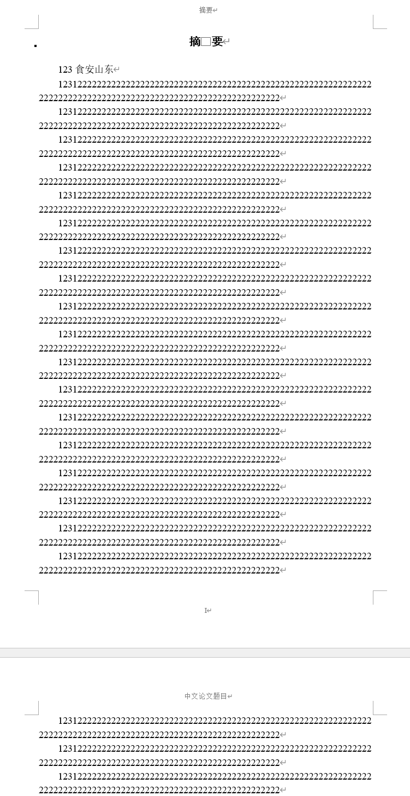
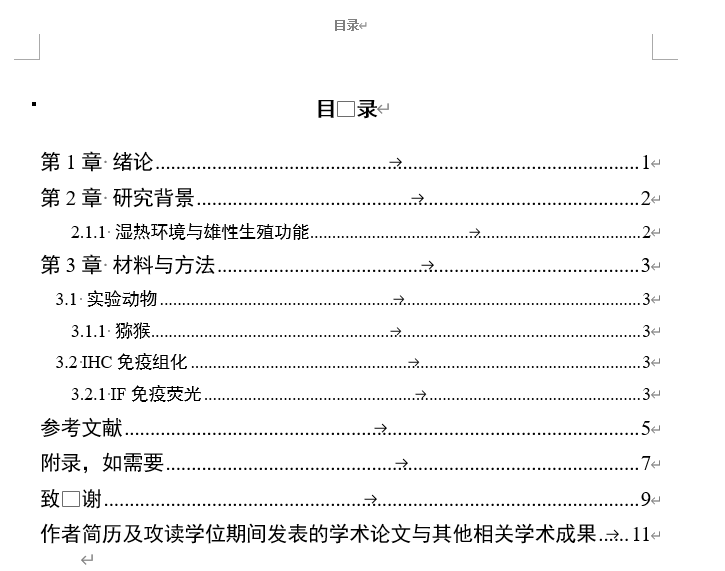
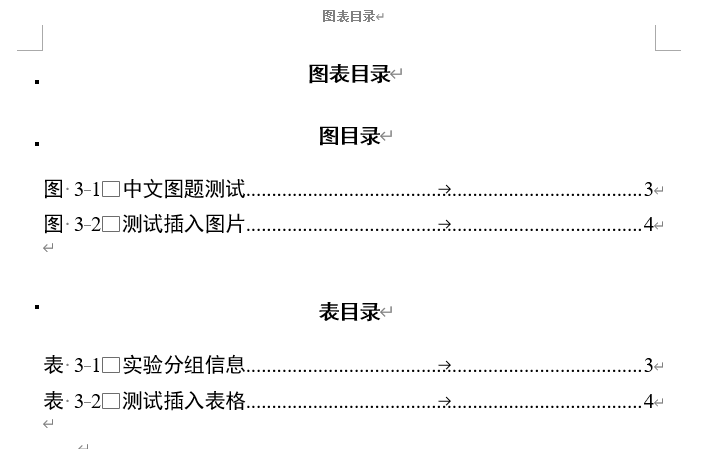
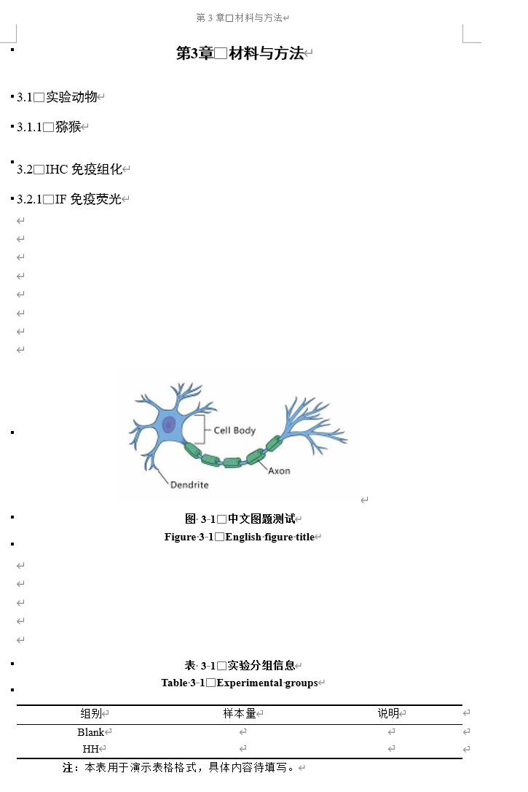
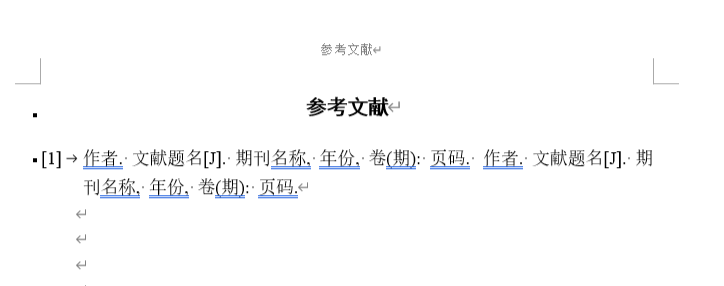

以下是按照操作来一天的对话生成的md
# 国科大 Word 学位论文模板搭建与使用手册

> 用途：从空白 Word 文档搭建论文模板，并用于后续撰写、插入图表、引用文献和更新目录。
>
> 环境：Windows 桌面版 Microsoft Word。不同版本的菜单名称可能略有差别。
>
> 依据：用户提供的《中国科学院大学研究生学位论文撰写规范指导意见》，2022年3月7日审议修订版。本手册区分“学校明确要求”和“本次采用的排版建议”，不将建议数值当作硬性规定。
>
> 本手册是操作记录，不表示已读取并逐项验证你最终 Word 文件的全部实际设置。
>
> 原规范：[查看提供的规范文件](https://chatgpt.com/library?file_id=libfile_5b035edd4fdc8191923bfc3ae352d250&account_id=personal)

## 1. 先掌握的几个概念

### 1.1 样式负责外观，字段负责自动内容

| 功能 | 负责什么 | 例子 |
|---|---|---|
| 段落样式 | 字体、字号、对齐、缩进、行距、段前后间距、分页行为 | 论文正文、图中文题名 |
| 多级列表 | 章节自动编号及层级关系 | 第1章、1.1、1.1.1 |
| 题注 | 图表自动编号 | 图3-1、表3-1 |
| 书签 | 为一段内容设置固定名称 | Fig_Design |
| 交叉引用 | 在其他位置引用已存在的内容 | 英文题名引用中文图号 |
| 分节符 | 划分可以分别设置页眉、页脚、页码的部分 | 摘要与正文分开 |
| 目录域 | 根据指定标题或题注生成条目和页码 | 正文目录、图目录 |

图题样式不会自动添加图号，也不会自动在图号和题名之间插入空格。

### 1.2 新建与修改样式的入口

- 打开样式窗格：Ctrl + Alt + Shift + S。
- 新建样式：点击样式窗格底部的“新建样式”。
- 修改样式：右键样式名称 → 修改。
- 字体、段落、编号、制表位：在“修改样式”窗口左下角的“格式”菜单中设置。
- 应用段落样式：将光标放在该段中，不选中部分文字，再点击样式。

### 1.3 通用原则

1. 同类内容统一使用同一个样式。
2. 新建无编号样式时，从确认没有编号的普通段落开始。
3. 本手册中的自定义段落样式，默认“自动更新”不勾选、“添加到样式库”勾选、保存范围为“仅限此文档”。
4. 为避免带入旧编号，无编号自定义样式可使用“样式基准：（无样式）”，再明确填写参数。
5. 样式的“自动更新”与“更新目录/更新字段”无关；关闭前者不妨碍更新目录和编号。
6. 参数未出现在样式描述中，不代表它一定正确或错误，应打开相应窗口确认。
7. 新建样式前先双击正文，退出页眉/页脚编辑区域。

### 1.4 容易混淆的样式

| 名称 | 说明 |
|---|---|
| 正文 | Word 内置的默认段落样式之一；与自建的“1 论文正文”不是同一个样式 |
| 1 论文正文 | 本次创建的论文普通段落样式 |
| 默认段落字体 | 内置字符样式，让文字跟随所在段落的字体规则；保留或隐藏即可 |
| 标题1/标题2/标题3 | Word 内置标题样式 |
| 2 标题1、3 标题2、4 标题3 | 本次曾创建的独立自定义样式；名称前的数字只是名称的一部分，不等于自动编号 |

内置标题常显示为“链接（段落和字符）”类型，保持即可。应用时只把光标放在整段中；只选部分文字时，可能仅应用字符格式。

## 2. 字号对照表

| 中文字号 | 磅值 |
|---|---:|
| 小三 | 16 |
| 四号 | 14 |
| 小四 | 12 |
| 五号 | 10.5 |
| 小五 | 9 |

“黑体”是字体名称，“加粗”是字形效果，是两项不同设置。

## 3. 新建文档与页面基础

### 3.1 新建并保存

1. Word → 空白文档。
2. 保存为 Word 文档（.docx），例如“硕士学位论文_基础模板.docx”。
3. 确认没有处于旧版“兼容模式”。
4. 按 Ctrl + Shift + 8，开启 ¶ 编辑标记。

编辑标记可帮助识别段落、空格、分页符和分节符，不会作为这些标记本身打印。

### 3.2 页面设置

入口：布局 → 页边距 → 自定义页边距。

| 项目 | 设置 |
|---|---|
| 纸张 | A4，21 × 29.7厘米 |
| 方向 | 纵向 |
| 上、下边距 | 各2.54厘米 |
| 左、右边距 | 各3.17厘米 |
| 装订线 | 0厘米；规范没有要求另加，先按此设置 |
| 多页 | 普通 |
| 页眉距边界 | 1.5厘米 |
| 页脚距边界 | 1.5厘米 |
| 垂直对齐 | 顶端 |
| 应用于 | 整篇文档 |

正文可用宽度：

    21 − 3.17 − 3.17 = 14.66厘米

普通竖向页面中的图片、表格不要超出正文区域。

### 3.3 文档网格

页面设置 → 文档网格 → 无网格。

各样式中同时取消：

- 字体窗口：“如果定义了文档网格，则对齐到网格”。
- 段落窗口：“如果定义了文档网格，则与网格对齐”。
- 段落窗口：“如果定义了文档网格，则自动调整右缩进”。

字体窗口的网格主要涉及横向字符排列；段落窗口的网格主要涉及纵向行排列。

“对称缩进”不勾选。本模板暂不使用按内侧/外侧区分的段落缩进。

### 3.4 字间距相关开关

- 字符缩放100%，间距标准，位置标准。
- “为字体调整字间距”是针对某些字符组合的字距调整，可保留勾选；不是统一加宽或紧缩全部字符。
- “小四磅或更大”表示该功能的字号门槛。
- “自动调整中文与数字/西文的间距”产生的是排版间隔，不是实际空格字符。

## 4. 普通正文样式

样式名称：1 论文正文。

| 项目 | 设置 |
|---|---|
| 样式类型 | 段落 |
| 中文字体 | 宋体 |
| 西文字体 | Times New Roman |
| 字号/字形 | 小四12磅、常规 |
| 颜色 | 黑色 |
| 对齐方式 | 两端对齐 |
| 左右缩进 | 0 |
| 特殊格式 | 首行缩进2字符 |
| 段前/段后 | 0/0磅 |
| 行距 | 多倍1.25 |
| 大纲级别 | 正文文本 |
| 编号 | 无 |
| 后续段落样式 | 1 论文正文 |
| 孤行控制 | 勾选 |
| 与下段同页 | 不勾选 |
| 段中不分页 | 不勾选 |
| 段前分页 | 不勾选 |

前三项分页开关是本次采用的排版设置。普通正文允许跨页。

日常输入：段首直接打字，段落结束按一次回车；不用手打空格制造首行缩进。

## 5. 正文章节标题与多级编号

### 5.1 当前模板的样式对应

| 内容 | 当前可继续使用的样式 |
|---|---|
| 章标题 | Word内置“标题1” |
| 二级标题 | 自定义“3 标题2” |
| 三级标题 | 自定义“4 标题3” |

章标题曾使用独立的“2 标题1”，后来为兼容标准题注章号功能，迁移到了内置“标题1”。

以后重新从零制作模板时，可直接修改内置“标题1、标题2、标题3”，减少兼容性问题。当前已经正常工作的二、三级自定义样式可以保留。

### 5.2 标题参数

中文字体均为黑体，西文及数字均为 Times New Roman，颜色黑色，特殊格式为无，左右缩进0，行距单倍。

| 项目 | 章标题 | 二级标题 | 三级标题 |
|---|---|---|---|
| 字号 | 四号14磅 | 小四12磅 | 小四12磅 |
| 字形 | 加粗 | 常规 | 常规 |
| 对齐 | 居中 | 左对齐 | 左对齐 |
| 大纲级别 | 1级 | 2级 | 3级 |
| 段前 | 24磅 | 24磅 | 12磅 |
| 段后 | 18磅 | 6磅 | 6磅 |
| 后续样式 | 1 论文正文 | 1 论文正文 | 1 论文正文 |
| 与下段同页 | 勾选 | 勾选 | 勾选 |
| 段中不分页 | 勾选 | 勾选 | 勾选 |
| 段前分页 | 勾选 | 不勾选 | 不勾选 |

段前分页让每章另起一页。正文内部各章不要求全部从奇数页开始。

### 5.3 建立多级编号

光标放在一个章标题中：

开始 → 多级列表旁的小箭头 → 定义新的多级列表 → 更多。

在同一个窗口中依次设置1、2、3级，最后统一确定。需要时将更改应用于“整个列表”。

| 列表级别 | 链接到样式 | 编号外观 | 重新计数 |
|---|---|---|---|
| 1 | 内置标题1 | 第1章 | 起始1，章间连续 |
| 2 | 当前二级标题样式 | 1.1 | 在级别1后重新开始 |
| 3 | 当前三级标题样式 | 1.1.1 | 在级别2后重新开始 |

每级的位置设置：

| 项目 | 设置 |
|---|---|
| 编号对齐方式 | 左对齐；章标题整段仍按样式居中 |
| 对齐位置 | 0厘米 |
| 文本缩进位置 | 0厘米 |
| 编号之后 | 无/不特别标注 |
| 编号与题名间隔 | 在编号格式末尾加一个全角空格 |

编号格式示意：

    第〔本级自动数字〕章〔全角空格〕
    〔级别1数字〕.〔本级自动数字〕〔全角空格〕
    〔级别1数字〕.〔级别2数字〕.〔本级自动数字〕〔全角空格〕

“第”和数字之间、数字和“章”之间，本次统一不再额外留空格。

必须通过“此级别的编号样式”和“包含的级别编号来自”插入自动数字，占位数字通常有灰底。不要把整个1.1或1.1.1手打成普通文字。

### 5.4 新增章节

1. 新建一个独立段落。
2. 只输入标题文字。
3. 应用相应级别的标题样式。
4. Word自动生成编号。
5. 用导航窗格检查层级。

不要用空的“标题1”段落撑开页面，否则它可能参与编号，造成跳号或空目录条目。

### 5.5 自定义章标题迁移到内置标题1

标准题注编号窗口只列出内置标题级别时，独立自定义样式不能直接加进该下拉菜单。

迁移方法：

1. 光标放在外观正确的旧章标题中。
2. 右键内置“标题1” → 更新“标题1”以匹配所选内容。
3. 修改其后续样式为“1 论文正文”，关闭自动更新，确认大纲1级、段前分页。
4. 打开现有多级列表定义，把第1级改为链接内置“标题1”；保留2、3级原有规则。
5. 右键旧“2 标题1” → 选择所有实例 → 应用内置“标题1”。
6. 检查章、节编号及题注章号；验证后再清理旧样式。

## 6. 前置标题与无编号章标题

两类标题都不编号，但目录收录方式不同。

| 项目 | 前置标题 | 无编号章标题 |
|---|---|---|
| 用途 | 摘要、Abstract、目录、图表目录等 | 参考文献、附录、致谢、作者简历及成果 |
| 中文/西文字体 | 黑体/Times New Roman | 同左 |
| 字号/字形 | 四号14磅、加粗 | 同左 |
| 对齐/行距 | 居中、单倍 | 同左 |
| 段前/段后 | 24/18磅 | 同左 |
| 左右缩进/特殊格式 | 0/无 | 同左 |
| 编号 | 无 | 无 |
| 大纲级别 | 正文文本 | 1级 |
| 后续样式 | 1 论文正文 | 1 论文正文 |
| 与下段同页/段中不分页 | 勾选/勾选 | 勾选/勾选 |
| 段前分页 | 不勾选，主要起始页由分节控制 | 勾选，奇数页起始另由分节控制 |
| 进入正文目录 | 不收录 | 收录为目录1级 |

标题文字中的空格需要输入，样式不会自动插入：

    摘　要
    目　录
    致　谢
    Abstract
    图表目录

“前置标题_无编号”如果仍是你保留的有效样式，可以继续用它，不必为了名称重新建一套。

### 6.1 无编号样式意外出现章号

若描述中出现“多级符号＋级别2……”等，说明带有列表规则。

排查顺序：

1. 确认给整段应用样式，而不是只给部分字符应用。
2. 在样式中设置“格式 → 编号 → 无”。
3. 大纲级别与是否编号是两个独立属性，改成正文文本并不能自动取消列表。
4. 检查多级列表各级实际关联的样式，前置标题不应链接到任何编号级别。
5. 检查基础正文样式是否也带了编号。
6. 对已有段落按Ctrl + Q，清除额外段落格式。
7. 仍不正常时，从干净的内置正文段落新建样式，基准选“无样式”，逐项填写，不沿用错误旧样式。
8. 确认成功后再替换旧样式，避免保留多套同用途样式。

## 7. 图表题名、注释及插图段落

### 7.1 四个题名样式

名称可保留你已有的“6 ……”前缀。

共同参数：

- 段落样式；无编号；大纲级别为正文文本。
- 中文宋体，西文及数字 Times New Roman。
- 五号10.5磅、加粗、黑色、居中。
- 左右缩进0，特殊格式无。
- 多倍1.25行距，关闭网格相关选项。
- 段中不分页勾选，段前分页不勾选。

| 样式 | 段前 | 段后 | 与下段同页 | 后续样式 |
|---|---:|---:|---|---|
| 图中文题名 | 6磅 | 0磅 | 勾选 | 图英文题名 |
| 图英文题名 | 0磅 | 12磅 | 不勾选 | 图表注释 |
| 表中文题名 | 6磅 | 0磅 | 勾选 | 表英文题名 |
| 表英文题名 | 0磅 | 12磅 | 勾选 | 1 论文正文 |

表中文题名连接英文表题，英文表题连接表格开头，不要求整张长表同页。

### 7.2 图表注释

| 项目 | 设置 |
|---|---|
| 字体 | 中文宋体；西文Times New Roman |
| 字号/字形 | 五号10.5磅、常规 |
| 对齐 | 本模板采用两端对齐 |
| 行距 | 多倍1.25 |
| 段前/段后 | 0/0磅 |
| 左侧缩进 | 4字符 |
| 特殊格式 | 悬挂2字符 |
| 右侧缩进 | 0 |
| 编号/大纲 | 无/正文文本 |
| 后续样式 | 1 论文正文 |
| 孤行控制 | 勾选 |
| 与下段同页/段前分页/段中不分页 | 均不勾选 |

采用全角“注：”时，上述缩进使第一行从左边界后2字符开始，续行从4字符处开始，对齐到说明文字起点。以标尺和实际显示核对。

只将“注”字加粗，说明内容保持常规。图注位于图题下方，表注位于表格下方。

### 7.3 插图段落

| 项目 | 设置 |
|---|---|
| 用途 | 图片单独所在的段落 |
| 类型/基准 | 段落/无样式 |
| 字体 | 宋体/Times New Roman，小四12磅、常规 |
| 对齐 | 居中 |
| 左右缩进/特殊格式 | 0/无 |
| 行距 | 单倍，不用较小的固定行距 |
| 段前/段后 | 本模板建议6/0磅，非学校单列硬性数值 |
| 与下段同页/段中不分页 | 勾选/勾选 |
| 段前分页 | 不勾选 |
| 编号/大纲 | 无/正文文本 |
| 后续样式 | 图中文题名 |

图片采用“嵌入型”。图片段落与中文图题相连，中文图题再与英文图题相连；整组能放进一页时，尽量一同换页。

学校给出的高6厘米、宽8厘米是一般建议，可按比例调整。锁定纵横比，不把不同形状的图片硬拉成8×6厘米。

## 8. 每次新增一张图片：完整流程

### 8.1 插入图片与中文题注

1. 在对应章节正文中的目标位置，新建空段落。
2. 应用“插图段落”。
3. 插入 → 图片 → 此设备。
4. 图片格式 → 环绕文字 → 嵌入型。
5. 锁定纵横比，调整宽度，保证在正文区域内。
6. 选中图片 → 引用 → 插入题注。
7. 标签选“图”；没有就新建标签“图”；位置选“所选项目下方”。
8. 点击编号：格式1、2、3；包含章节号；章节起始样式“标题1”；分隔符“-”。
9. 在自动图号后输入一个全角空格和完整中文题名，再确定。
10. 单击生成的题注段落，应用“图中文题名”。

例如：

    图 3-1　实验设计

题注通常先使用内置“题注”样式，再手动应用自建题名样式即可。换样式不会删除自动编号。

### 8.2 为该图建立唯一书签

若要让英文题名编号同步：

1. 只选中中文题注中的自动编号，例如3-1。
2. 不选“图”，不选编号后的空格、题名或段落标记。
3. 插入 → 书签。
4. 使用唯一名称，例如Fig_Design、Fig_HE，点击添加。

命名以字母开头，不含空格，可用下划线。按内容命名比按当前图号命名更稳定：图号改变时无需改书签名称。

### 8.3 插入英文题名

1. 中文图题后另起一段，应用“图英文题名”。
2. 输入Figure及一个普通半角空格。
3. 引用 → 交叉引用。
4. 引用类型“书签”，引用内容“书签文字”，选择本图书签。
5. 插入后关闭窗口。
6. 在引用编号之后加一个全角空格，再输入英文题名。
7. 下方需要说明时，应用“图表注释”。

例如：

    Figure 3-1　Experimental design

英文编号是对中文编号的引用，不另外建立Figure计数序列。

### 8.4 更新与检查

- Ctrl + A → F9，更新正文中的相关域。
- 若英文引用尚未跟随最新源图号，右键英文编号 → 更新域；必要时再更新一次。
- 检查中英文编号一致。
- 检查中文/英文题名样式、图号后的全角空格。
- 图片位置或章节变化后重新更新。

书签不是中文图号自动生成的必要条件；它是本手册采用的中英文编号同步方式所需的关联。

### 8.5 新图片是否还要建书签

| 情况 | 是否手动建书签 |
|---|---|
| 只插中文自动题注 | 不需要 |
| 英文题名同步引用中文图号 | 每张新图需要自己的书签 |
| 根据“图”标签生成图目录 | 不需要额外建书签 |

每张新图不能复用旧图的书签名称。复制旧英文题名后，必须重新绑定到新图书签，否则仍会引用旧图。

## 9. 图号、表号后全角空格：已确认的规则

学校要求“图序与图题文字之间空一个汉字符位”，表序与表题同理。本模板采用一个真实的全角空格实现。

可复制两个括号中间的空白，不含括号：

    【　】

| 位置 | 本模板采用的间隔 |
|---|---|
| 中文图号/表号与题名之间 | 一个全角空格 |
| Figure/Table与编号之间 | 一个普通半角空格 |
| 英文编号与英文题名之间 | 一个全角空格 |

重要区别：

1. 中英文或中文与数字的自动间距不是实际空格。
2. 可临时取消“段落 → 中文版式 → 自动调整中文与数字的间距”来判断小间隔来源。
3. 图题样式不会自动插入空格。
4. 章节多级编号中设置的末尾空格，不会替图表题注添加间隔。
5. 在题注窗口中，将“自动编号＋全角空格＋完整题名”一起插入，不仅在末尾留下空格就确定。
6. 已插入的题注，可直接在第一个题名字前补全角空格，不改编号域。
7. 编辑标记开启时，全角空格可能显示为小方框；关闭编辑标记后应只剩空白。如果方框仍在，检查是否误输入了实际的“□”字符。
8. 不重复叠加空格，以实际字符和显示为准。
9. 保存可复用中文图题/表题部件时，一并保存这个全角空格。

## 10. 三线表与表格正文

### 10.1 表格正文样式

| 项目 | 设置 |
|---|---|
| 字体 | 宋体/Times New Roman |
| 字号/字形 | 本模板建议五号10.5磅、常规；表头另外加粗 |
| 对齐 | 短文本及数字可居中；长文本列可按内容改左对齐 |
| 左右缩进/特殊格式 | 0/无 |
| 行距 | 本模板采用多倍1.25 |
| 段前/段后 | 0/0磅 |
| 编号/大纲 | 无/正文文本 |
| 后续样式 | 表格正文 |
| 与下段同页/段前分页 | 不勾选 |
| 网格相关选项 | 不勾选 |

学校明确了图表题注和表注的字号，但未在已读条目中单独规定所有表内文字的固定字号；五号是本模板的统一建议。

### 10.2 建立三线表

1. 插入一张表格，填入表头和占位内容。
2. 选中整表，应用“表格正文”；第一行文字加粗。
3. 表格属性：居中，文字环绕“无”。
4. 布局 → 自动调整 → 根据窗口调整表格，或按内容设置合适宽度。
5. 表格设计 → 边框 → 无框线。
6. 选中整表，黑色实线、建议1.5磅，分别添加上框线和下框线。
7. 只选第一行，建议0.75磅，添加下框线。
8. 保留顶线、表头下横线、底线，不加竖线。

1.5磅和0.75磅为本次排版建议，规范没有指定线宽。更改线宽后，还需要再点击对应边框命令才会应用。

浅灰色网格线是编辑辅助线，不等于实际打印边框。

### 10.3 跨页设置

- 选中表头行 → 表格布局 → 重复标题行。
- 选中整表 → 表格属性 → 行 → 取消“允许跨页断行”，尽量保持一行完整。
- 行高保持自动，不设过小的固定值。
- 长表仍允许在行与行之间跨页，不要将全部数据段落勾成“与下段同页”。
- 规范要求跨页表标“续表”并重复表头；“重复标题行”不会自动生成“续表”字样，需在正式长表排版时单独处理。
- 数据列保持上下对齐，必要时按小数位对齐。
- “空白”“未检出”“实测为0”含义不同，不混用；缩写在表注中说明。

## 11. 每次新增一张表格：完整流程

### 11.1 插入或复制表格

最方便的起点是复制已经调好的三线表：

1. 只选表格本身，不含中英文表题和书签。
2. 粘贴到目标章节的正文位置，保留合适格式。
3. 修改数据、行列，检查宽度和边框。
4. 检查表内样式、表头加粗及跨页设置。

### 11.2 插入中文表题

1. 选中整张表 → 引用 → 插入题注。
2. 标签“表”；位置“所选项目上方”。
3. 编号：包含章节号；章节起始样式“标题1”；分隔符“-”。
4. 自动编号后输入一个全角空格和完整中文表题。
5. 插入后应用“表中文题名”。

例如：

    表 3-1　实验分组信息

图和表是独立计数序列：同一章可以同时有图3-1和表3-1。

### 11.3 建书签并插入英文表题

1. 只选中中文表号3-1，添加唯一书签，例如Tab_Groups。
2. 中文表题末尾按回车，在表题与表格之间建立英文段落。
3. 应用“表英文题名”。
4. 输入Table及一个半角空格。
5. 引用 → 交叉引用 → 书签 → 书签文字，选择该表书签。
6. 引用编号后加一个全角空格，输入英文题名。

例如：

    Table 3-1　Experimental groups

### 11.4 表注与排列检查

顺序固定为：

1. 中文表题。
2. 英文表题。
3. 三线表。
4. 表注。

表注应用“图表注释”，仅“注”字加粗。中文、英文表题样式都勾选“与下段同页”，让两行表题随表格开头一起换页。

最后更新编号和引用，检查后保存。

## 12. 自动正文目录

### 12.1 准备位置

目录最终位于中英文摘要之后、正文之前。

- 标题“目　录”应用“前置标题”。
- 下一独立段落用于插入自动目录，不手打目录条目。
- 图表目录随后另页编排。

### 12.2 插入目录

引用 → 目录 → 自定义目录：

| 选项 | 设置 |
|---|---|
| 显示页码 | 勾选 |
| 页码右对齐 | 勾选 |
| 前导符 | 点线 |
| 格式 | 来自模板 |
| 显示级别 | 3 |

选项 → 建立目录依据：

- 样式：勾选。
- 大纲级别：取消勾选。
- 目录项域：不勾选。
- 清除不用样式右侧的目录级别，只明确映射需要的样式。

| 实际样式 | 目录级别 |
|---|---:|
| 内置标题1 | 1 |
| 当前二级标题样式，例如3 标题2 | 2 |
| 当前三级标题样式，例如4 标题3 | 3 |
| 无编号章标题 | 1 |

前置标题、摘要正文、正文、图表题名、注释等不填目录级别。规范明确正文目录不包括中英文摘要。

### 12.3 目录条目的样式

在自定义目录窗口 → 修改 → 依次修改“目录1、目录2、目录3”。

共同设置：中文黑体，西文及数字 Times New Roman，常规、黑色、单倍行距、段前6磅、段后0磅，两端对齐，右缩进0，特殊格式无，大纲正文文本，编号无，关闭自动更新和网格相关选项。

| 样式 | 字号 | 左缩进 |
|---|---|---:|
| 目录1 | 四号14磅 | 0字符 |
| 目录2 | 小四12磅 | 1字符 |
| 目录3 | 小四12磅 | 2字符 |

不勾选段前分页、与下段同页，避免目录条目串成大块。不清除原有右对齐制表位，不手打点线。

“使用前隐藏”和优先级主要影响样式列表显示，不影响目录内容。

### 12.4 更新

右键目录 → 更新域/更新目录 → 更新整个目录。

只有标题已套用正确样式，目录才能正确生成。不要手改生成条目来代替修改正文标题；目录外观通过目录1/2/3样式统一调整。

## 13. 图目录和表目录

### 13.1 排列

正文目录之后，准备：

- 图表目录：前置标题。
- 图目录：分区标题，本模板先用前置标题。
- 自动图目录。
- 表目录：分区标题，本模板先用前置标题。
- 自动表目录。

图表目录整体另页编排，先图后表。图目录和表目录可以在同一页自然排列，不必各自强制一页。

### 13.2 插入

光标放在“图目录”下方、现有目录域之外的独立空段落：

引用 → 题注区域 → 插入表目录/插入图表目录。

| 选项 | 图目录 | 表目录 |
|---|---|---|
| 题注标签 | 图 | 表 |
| 包括标签和编号 | 勾选 | 勾选 |
| 显示页码/页码右对齐 | 勾选 | 勾选 |
| 前导符 | 点线 | 点线 |
| 格式 | 来自模板 | 来自模板 |

两个目录分别插入，不覆盖彼此。按题注标签收集内容，英文书签引用不会另外生成同标签的计数条目。

### 13.3 图表目录条目样式

窗口 → 修改 → “图表目录”样式：

| 项目 | 设置 |
|---|---|
| 中文/西文字体 | 黑体/Times New Roman |
| 字号/字形 | 四号14磅、常规 |
| 对齐 | 两端对齐 |
| 左右缩进/特殊格式 | 0/无 |
| 行距 | 单倍 |
| 段前/段后 | 6/0磅 |
| 大纲/编号 | 正文文本/无 |
| 自动更新、段前分页、与下段同页 | 不勾选 |

保留右对齐制表位。这里的“图表目录”是内置条目样式，页面上同名标题仍用“前置标题”，二者不同。

分别右键图目录、表目录 → 更新整个目录。

## 14. 论文分节与奇数页起始

### 14.1 内容顺序与分节规划

| 部分 | 分节方式 | 页码规划 |
|---|---|---|
| 中文封面、英文封面、声明 | 可共同放在第一节，内部按需要分页 | 不显示页码 |
| 中文摘要 | 标题前插奇数页分节符 | 大写罗马数字，从I开始 |
| 英文摘要 | 标题前插奇数页分节符 | 续前节 |
| 目录 | 标题前插奇数页分节符 | 续前节 |
| 图表目录 | 主标题前插奇数页分节符 | 续前节 |
| 符号说明，如有 | 标题前插奇数页分节符 | 续前节 |
| 正文第一章 | 标题前插奇数页分节符 | 阿拉伯数字，从1开始 |
| 正文内部各章 | 本模板不另分节，标题样式段前分页 | 正文连续 |
| 参考文献 | 标题前插奇数页分节符 | 续前节 |
| 附录，如有 | 同上 | 续前节 |
| 致谢 | 同上 | 续前节 |
| 作者简历及成果 | 同上 | 续前节 |

图目录、表目录之间不用分节。

### 14.2 插入方法

1. 光标放在新部分标题最开头。
2. 若该边界已有手动分页符，先去掉重复分页符。
3. 布局 → 分隔符 → 分节符 → 奇数页。
4. 每个边界保留一个合适分节符，不再叠加多个分页符或空段落。

Ctrl + Enter只插分页符，不能代替分节。

开启¶检查“分节符（奇数页）”；需要时切换“视图 → 草稿”。右键状态栏勾选“节”，可检查光标所在节号。

奇数页分节可能自动补空白页，这是为保证下一部分在双面排版右页开始。先保留，最终通过打印预览核查。

### 14.3 两种“连续”不要混淆

- “页码格式 → 续前节”：控制数字连续。
- “链接到前一节”：控制页眉/页脚内容是否共用。

取消链接不会自动把页码设为1，保持链接也不等于自动连续编号。

## 15. 页码格式、位置与链接

### 15.1 先设置编号规则

光标放在各节正文中：

插入 → 页码 → 设置页码格式。

| 部分 | 格式 | 页码编排 |
|---|---|---|
| 中文摘要 | I、II、III，大写 | 起始值1，即I |
| 英文摘要、目录、图表目录、符号说明 | 大写罗马数字 | 续前节 |
| 正文第一章 | 1、2、3 | 起始值1 |
| 参考文献、附录、致谢、作者简历 | 1、2、3 | 续前节 |

“包含章节号”不勾选。前置各节不要都重新设为I，正文后的各节不要都重新设为1。

### 15.2 页脚通用格式

- 字体 Times New Roman，小五9磅，常规、黑色。
- 页脚距下边界1.5厘米。
- 左右缩进0，特殊格式无。
- 建议段前后0、单倍行距。
- 开启“奇偶页不同”。
- 显示页码的节，“首页不同”不勾选。
- 用“页码 → 当前位置 → 普通数字”插入自动页码，不手打数字。

### 15.3 中文摘要：奇偶页脚分别设置

1. 双击中文摘要第一页页脚。
2. 确认是“奇数页页脚”且节号正确。
3. 关闭“链接到前一节”，确认“与上一节相同”消失。
4. Ctrl + E居中，插入自动页码，设置9磅。
5. 到本节偶数页页脚，同样单独关闭链接，居中插入页码。

奇、偶页脚的链接独立，关闭其中一个不影响另一个。

摘要只有一页时，可在本节末尾、下一分节符之前加临时普通段落，在其前按Ctrl + Enter，产生可编辑的第二页。设置完再删除临时文字和对应手动分页符，保留分节符。自动补出的空白页不适合用来编辑页脚。

### 15.4 其他前置部分

英文摘要、目录、图表目录等：

- 奇、偶页脚均可保持链接到前一节，沿用居中布局。
- 编号格式仍为罗马数字、续前节。
- 某节页码不显示时，检查对应奇/偶页脚的链接状态。

### 15.5 正文：外侧页码

1. 正文奇数页页脚关闭链接到前一节。
2. 保留已有自动页码；没有才插入，避免重复。
3. Ctrl + R，右对齐。
4. 正文偶数页页脚也单独关闭链接，Ctrl + L左对齐。
5. 两种页脚均使用Times New Roman 9磅。

结果：奇数页右下，偶数页左下。

参考文献等后续节的两种页脚保持链接，页码格式设阿拉伯数字、续前节。

### 15.6 检查

- 封面和声明无页码。
- 中文摘要从I开始，前置页码居中。
- 正文从1开始，奇数右、偶数左。
- 参考文献等继续正文编号。
- 自动补白页会占用页序，其页眉页脚的实际显示以打印预览为准，不以“某页没看到页码”直接判断断号。

## 16. 页眉：部分名称、自动章名和论文题目

### 16.1 页眉样式

修改内置“页眉”样式：

| 项目 | 设置 |
|---|---|
| 中文/西文字体 | 宋体/Times New Roman |
| 字号/字形 | 小五9磅、常规 |
| 颜色/对齐 | 黑色/居中 |
| 左右缩进/特殊格式 | 0/无 |
| 行距/段前后 | 单倍/0磅 |
| 大纲/编号 | 正文文本/无 |
| 自动更新 | 不勾选 |
| 页眉距上边界 | 1.5厘米 |

页眉和页脚的链接相互独立，页脚已经断开时，页眉仍需单独设置。

### 16.2 各部分内容

| 部分 | 奇数页页眉 | 偶数页页眉 |
|---|---|---|
| 封面、声明 | 无 | 无 |
| 中文摘要 | 摘要 | 中文论文题目 |
| 英文摘要 | Abstract | 英文论文题目 |
| 目录 | 目录 | 中文论文题目 |
| 图表目录 | 图表目录 | 中文论文题目 |
| 符号说明 | 符号说明 | 中文论文题目 |
| 正文 | 当前章编号和章名 | 中文论文题目 |
| 参考文献、附录、致谢等 | 对应部分名称 | 中文论文题目 |

奇数页名称变化的各节，进入奇数页页眉后关闭链接再修改。

偶数页页眉：

- 中文摘要先断开封面链接，填写中文论文题目。
- 英文摘要断开链接，填写英文论文题目。
- 目录断开链接，改回中文论文题目。
- 后续同样显示中文论文题目的节可以保留链接。

题目尚未确定时可留明确占位文字，定稿前替换。

### 16.3 正文自动章名

正文奇数页页眉关闭链接到前一节，清除继承文字，应用“页眉”样式。

插入两个真实域：

1. Ctrl + F9，在括号内输入：STYLEREF 1 \n
2. 移到括号外。
3. 再按Ctrl + F9，在第二对括号内输入：STYLEREF 1
4. 更新域，必要时Alt + F9切换代码与结果。

本次实际使用的形式：

    { STYLEREF 1 \n }{ STYLEREF 1 }

第一个域读取章编号，第二个读取章名；1指内置标题1，并非固定第1章。

本模板的章编号格式本来已经带全角间隔，编号域会带出该间隔，所以两个域直接相连，不再加一个空格。若其他模板的编号域没有带出间隔，则以最终效果为准，在两个域间补一个适当间隔。

切勿直接键入普通大括号；必须用Ctrl + F9创建域。

### 16.4 新章从偶数页开始怎么办

正常。页眉按页面奇偶决定：

| 页面 | 页眉 |
|---|---|
| 偶数页，即使是新章第一页 | 论文题目 |
| 奇数页 | 当前章编号和名称 |

正文内部新章可以从偶数页开始，不用全部改成奇数页起始。正文第一章及参考文献、致谢等主要部分仍按规范从右页起始。

### 16.5 更新页眉域

正文中的Ctrl + A → F9不保证覆盖页眉/页脚等所有区域。页眉显示未更新时，在页眉中右键对应域 → 更新域，并通过打印预览检查。

## 17. 摘要正文与关键词

三个自定义样式均为段落样式，基准可设无样式，编号无、大纲正文文本、关闭自动更新和网格相关选项。

共同参数：中文宋体、西文Times New Roman，小四12磅、常规、黑色，多倍1.25行距，段前后0。

| 样式 | 对齐 | 特殊格式 | 后续样式 |
|---|---|---|---|
| 中文摘要正文 | 两端对齐 | 首行2字符 | 中文摘要正文 |
| 英文摘要正文 | 本模板采用两端对齐 | 无 | 英文摘要正文 |
| 关键词 | 左对齐 | 无 | 1 论文正文 |

左右缩进0；孤行控制勾选，与下段同页和段前分页不勾选；摘要正文允许段中跨页。

说明：学校摘要参数表明确字体、字号、行距，但未单列中英文摘要的上述首行缩进和英文对齐方式；这里是本模板统一采用的设置。

### 17.1 摘要内容

- 摘要概括目的、内容、方法和结论，突出本研究成果。
- 不标注引用文献，避免公式、图表等。
- 中英文内容保持一致。
- 本规范未统一规定所有专业的中文摘要字数，由相应学科要求确定；不在模板中擅自固定字数。

### 17.2 关键词

- 与摘要正文之间空一行：正文结束按两次回车，在最后一段应用“关键词”。
- 3～5个。
- “关键词”和“Key Words”标签单独加粗，具体词语保持常规。
- 中文用中文逗号；英文用英文逗号，后接普通空格。
- 中英文词语对应，英文首字母按规范大写，专有名称保持正确写法。

排版示例：

    关键词：湿热暴露，猕猴，睾丸，单核转录组
    Key Words: Humid-heat exposure, Macaque, Testis, Single-nucleus RNA sequencing

这里只是排版占位示例，正式关键词依据论文内容确定。

## 18. 参考文献正文样式与缩进

### 18.1 本模板采用的方案

先按顺序编码制组织：正文引用采用方括号序号，规范示例为上标；文末按首次引用顺序排列。学校也允许著者—出版年制，选择后全文保持一致。

参考文献标题继续使用“无编号章标题”。

### 18.2 参考文献正文样式

| 项目 | 设置 |
|---|---|
| 类型/基准 | 段落/可用无样式 |
| 字体 | 宋体/Times New Roman |
| 字号/字形 | 小四12磅、常规 |
| 颜色/对齐 | 黑色/两端对齐 |
| 行距 | 多倍1.25 |
| 段前/段后 | 0/0磅 |
| 大纲/编号 | 正文文本/无 |
| 后续样式 | 参考文献正文 |
| 孤行控制/段中不分页 | 勾选/勾选 |
| 与下段同页 | 必须不勾选，避免多条文献串成大块 |
| 段前分页/网格相关选项 | 不勾选 |

整条文献一般正体，拉丁文生物学名等应斜体的内容例外。正式序号交给文献管理软件，不使用章节编号列表。

### 18.3 悬挂缩进以实际对齐为准

规范要求“续行缩进至编码之后”，未规定固定1厘米。

验收标准：

1. [1]等序号位于正文区域左边界，不是纸张边缘。
2. 第一行的作者文字位于序号之后。
3. 第二行及后续行与第一行作者文字的开头对齐。
4. 序号后用制表位/软件输出控制，不用连续空格凑位置。

此前讨论过左缩进1厘米和悬挂1厘米作为示例，但你的Word实际设置中，取消额外左缩进后才对齐。因此保留实际效果正确的设置，不机械套固定数值。

最可靠的调整方式：

1. 勾选视图 → 标尺。
2. 光标放在一条足够长、已自动换行的文献中。
3. 上三角代表首行位置，确认在正文左边界0处。
4. 下三角控制续行起点，移到第一行作者文字起点。
5. 左对齐制表位也放在内容起点。
6. 不拖底部矩形一起整体移动所有缩进。
7. 调好后右键“参考文献正文” → 更新以匹配所选内容，保存规则。

“字符”和“厘米”不能不加区分地照抄。样式描述里制表位与悬挂缩进数值看起来不一致时，优先检查实际首行、续行是否对齐。

### 18.4 每条文献与文末列表

- 每条文献作为独立段落。
- 文后参考文献集中放在正文之后，不按每章重复列。
- 正文引用与文后条目对应。
- 同一篇文献重复引用，顺序编码制使用同一序号。
- 规范参照GB/T 7714—2015或学科允许的格式；按本次提供的学校文件执行。
- 外文期刊名按该规范列全称；正式输出样式需要核对作者、刊名、卷期页码等细节。

## 19. 新增、修改、删除文献：文献管理软件

你尚未明确最终采用EndNote还是Zotero，以下提供两条路线。选定一条用于同一篇论文，避免同一文档交替由两套软件维护同一批引用。

Word“参考文献正文”控制排版；管理软件的输出样式/CSL负责作者、年份、序号、标点和条目结构。仅修改Word段落样式，不能保证改变软件生成的引用体例。

### 19.1 每次新增文献的共同流程

1. 将文献导入选定的软件文献库。
2. 核对条目类型、作者、题目、年份、期刊、卷期页码、DOI等；不要只信PDF自动识别结果。
3. 回到Word，把光标放在需要引用的句子位置。
4. 通过软件插件插入引用，不手打一个[1]冒充关联引用。
5. 由插件创建或更新文末参考文献列表。
6. 用插件刷新引用后，再更新Word目录、图号和交叉引用。
7. 检查正文引文格式、文末条目格式及悬挂对齐。

### 19.2 Zotero路线

Word → Zotero选项卡：

| 任务 | 命令 |
|---|---|
| 选择引用体例 | Document Preferences |
| 新增/编辑正文引用 | Add/Edit Citation |
| 插入/编辑文末列表 | Add/Edit Bibliography |
| 同步条目修改、重新计算引用 | Refresh |

操作：

1. Document Preferences中选择符合学校要求的体例。官方样式库可查找“China National Standard GB/T 7714-2015 (numeric, 中文)”；安装后仍核对上标、作者、刊名等是否与院所要求一致。
2. 光标放在引用位置，Add/Edit Citation搜索作者、题名或年份，选中文献并确认。
3. 在“参考文献”标题下的普通段落中使用Add/Edit Bibliography生成列表。
4. 改文献信息时先改Zotero库中的条目，再Refresh。
5. 修改一个引用组，用Add/Edit Citation，不在域显示结果中直接改序号。

Zotero的引用和文献结构由CSL控制；若刷新后结构/缩进反复恢复，应检查所选CSL及其设置，必要时使用符合院所要求的定制样式。自动生成列表的字体与段落可在Word中核对其实际使用样式，再与本手册参数统一，不假定它一定使用自建“参考文献正文”。

参考：[Zotero Word插件说明](https://www.zotero.org/support/word_processor_plugin_usage)、[插件格式问题说明](https://www.zotero.org/support/word_processor_plugin_troubleshooting)、[官方样式库](https://www.zotero.org/styles?q=GB%2FT+7714)。

### 19.3 EndNote路线

Word → EndNote选项卡，具体版本可能显示EndNote 21等。

| 任务 | 常用命令 |
|---|---|
| 查找并插入文献 | Insert Citation |
| 插入EndNote中选中的文献 | Insert Selected Citation(s) |
| 编辑一个引用组 | Edit & Manage Citation(s) |
| 刷新引用和文末列表 | Update Citations and Bibliography |
| 调整文末列表布局 | Configure Bibliography → Layout |

操作：

1. 打开实际使用的EndNote文献库。
2. 在Word插件中选择符合学校要求的Output Style。软件提供的同类GB/T样式也要逐项核对，不仅根据名字判断完全合规。
3. 光标置于引用位置，Insert Citation搜索并插入条目。
4. 用Update Citations and Bibliography更新正文引用和文末列表。
5. 需要时在Configure Bibliography的Layout中调整字号、缩进和行距；中文/西文字体在Word输出中另行核对。
6. 自定义Output Style时另存副本。条目结构及编号前后的Tab、悬挂规则，可在样式的Bibliography → Layout中配置，并与Word中的实际制表位对齐。
7. 元数据有误，修改EndNote库中条目后再更新。

参考：[官方插入引用说明](https://docs.endnote.com/docs/endnote/2025/v1/windows/en/content/09word/finding_n_inserting_cites.htm)、[官方引用更新说明](https://docs.endnote.com/docs/endnote/2025/windows/v1/content/09word/basic_instructions_word.htm)、[官方悬挂缩进说明](https://supportcenter.clarivate.com/s/article/EndNote-Configuring-a-Hanging-Indent?language=en_US)、[输出样式Bibliography Layout](https://docs.endnote.com/docs/endnote/2025/v1/windows/en/content/18styles/bibliography_layout.htm)。

说明：链接中部分页面为EndNote 2025官方说明；21版通常有相应命令，名称和位置以实际版本为准。

### 19.4 删除或合并引用

- 删除一个引用组中的某篇文献，优先使用插件的引用编辑窗口。
- 删除整段带引用的正文后，通过插件刷新检查编号和列表。
- 不手动把后面的[8]改为[7]，不直接删除文末一条来代替移除正文引用。
- 重复条目先在文献库中处理，再按软件支持的方式维护关联。
- 仍需编辑的主稿保留引用域。若提交环节确需纯文本副本，另存副本后再解除关联，不覆盖可编辑主稿。

### 19.5 插件刷新与F9的分工

| 命令 | 主要用途 |
|---|---|
| Zotero Refresh | Zotero引用、文末文献列表 |
| EndNote Update Citations and Bibliography | EndNote引用、文末文献列表 |
| Word Ctrl + A → F9 | 正文中的题注、交叉引用、目录等域 |
| 页眉中右键 → 更新域 | 页眉中的章名等域 |

不要将F9当作文献插件完整刷新命令的替代。

## 20. 已有的三页：中文封面、英文封面、声明

你已经有这三页，直接保留。以下记录规范参数，便于核对；并未读取你最终三页的所有实际格式。

### 20.1 中文封面

| 内容 | 明确要求 |
|---|---|
| 中文论文题目 | 黑体、小三16磅、加粗、居中、单倍行距 |
| 作者姓名、指导教师、学位类别、学科专业、培养单位 | 宋体四号14磅、加粗、2倍行距；按样张排列，英文和数字用Times New Roman |
| 日期 | Times New Roman四号14磅、加粗、居中；样张注明题目外采用2倍行距 |
| “硕士学位论文”固定字样 | 沿用统一样张；规范参数表未单独列其字号 |
| 校名、校徽等固定元素 | 保留学校规定版本，不自行替换图形 |

填写要求：

- 中文题目一般不宜超过25个汉字（符），必要时可加副标题。
- 导师填写姓名、专业技术职务、工作单位；列入者应符合学籍备案要求。
- 学科专业、培养单位用全称，与学籍一致。
- 日期用提交学位论文的年月，夏季批次一般6月、冬季一般12月。
- 公开论文不标密级，可删除该行。

### 20.2 英文封面

| 内容 | 明确要求 |
|---|---|
| 英文题目 | Times New Roman小三16磅、加粗、居中、单倍行距 |
| 作者、导师、学位、专业、培养单位 | Times New Roman四号14磅、加粗、居中，相关信息项2倍行距 |
| 学位申请说明等固定文字 | Times New Roman四号14磅、加粗、居中；未单列的行距按样张 |
| 日期 | Times New Roman四号14磅、加粗、居中；规范表未单列行距 |

- 硕士用thesis，博士用dissertation。
- 学校：University of Chinese Academy of Sciences。
- 姓名按规范姓全大写、名首字母大写；你的姓名写作ZHOU Chi。
- 学位、专业、单位使用正式全称。
- 2022规范附表列出生物与医药硕士英文名称：Master of Biological and Pharmaceutical Engineering；附表对调整后工程类英文名称有建议稿说明，正式封面仍核对学籍/培养单位采用版本。

### 20.3 原创性及授权声明页

包含：

1. 中国科学院大学研究生学位论文原创性声明。
2. 中国科学院大学学位论文使用授权声明。

使用统一原文及既有格式，保留签名、日期区域。规范要求提交时作者、导师亲笔签名。

该文件未像正文一样单列声明页完整的字体、字号、行距参数表，因此不擅自认定声明标题或正文必须采用某个自拟数值。

三页不应用章节自动编号，不进入目录，不显示页眉页码。

## 21. 附录、致谢和作者简历及成果

| 内容 | 标题 | 内容 |
|---|---|---|
| 附录 | 无编号章标题 | 可使用1 论文正文，按材料类型补充表格/代码等样式 |
| 致谢 | 无编号章标题 | 宋体小四，1.25倍，段前后0；末尾日期与封面一致 |
| 作者简历及成果 | 无编号章标题 | 宋体小四，英文数字Times New Roman，1.25倍，段前后0；论文清单按参考文献格式 |

作者简历一般从大学起填写学习、工作经历。成果列出攻读学位期间已发表或正式录用的论文及相关代表性成果，不把无关占位示例保留到正式稿。

未使用的附录、符号说明等部分可以不设；删除时同步检查分节、页眉页脚及目录。

## 22. 保存为.dotx模板与继续编辑

### 22.1 保存模板

1. 保留.docx工作文件。
2. F12另存为。
3. 类型选择Word模板（.dotx）。
4. 例如“国科大硕士论文模板.dotx”。

模板保存样式、分节、页眉页脚、目录域、正文框架和示例内容。另存并不自动清理测试文字，也不自动创建快速部件。

### 22.2 使用与修改的区别

| 目的 | 操作 |
|---|---|
| 基于模板写一篇论文 | 双击模板或通过Word的个人/自定义模板创建新文档，再保存为.docx |
| 修改模板本身 | Word → 文件 → 打开，选择.dotx文件；确认是在编辑模板后保存 |
| 日常保存论文 | Ctrl + S保存.docx，不覆盖原模板 |
| 更新模板规则 | 修改.dotx并保存；不假定旧论文会自动获得全部新设置 |

参考：[微软模板编辑说明](https://support.microsoft.com/en-us/word/edit-templates)。

## 23. 可复用部件：把自动图号后的空格一起保存

本节是可继续落实的模板完善操作，并不表示你当前文件已完成快速部件配置。

### 23.1 推荐保存的部件

| 部件 | 保存内容 |
|---|---|
| 中文图题_自动编号 | 中文题注字段＋一个全角空格＋中文题名占位文字＋段落样式 |
| 中文表题_自动编号 | 表题字段＋一个全角空格＋中文题名占位文字＋段落样式 |
| 论文三线表 | 无实际研究数据的表头、表格结构、边框及表内格式 |

英文书签引用不能简单作为同名书签的一部分反复插入；新图表仍需建立自己的书签和对应引用。

### 23.2 保存中文图题或表题

1. 在测试文档中插入一个新的标准中文题注，确认章号正常。
2. 在编号后添加一个真实全角空格，再写“中文图题待填写”或“中文表题待填写”。
3. 应用相应题名样式。
4. 这个用于保存的题注不要包含Fig_Test等手动书签，也不包含引用旧书签的英文行。
5. 选中完整题注段落，包含段落标记，以保留段落格式。
6. 插入 → 文档部件/快速部件 → 将所选内容保存到文档部件库。
7. 填写名称、分类，插入选项可选择单独段落。
8. “保存位置/Save in”选择你自己的论文.dotx模板。
9. 保存模板；关闭Word时如询问是否保存该模板的部件修改，确认保存。

如果保存位置列表没有你的模板：先通过Word打开/加载相应模板，再检查；不要仅保存在Normal.dotm后就认为已随论文模板一起保存。暂时也可以保留干净样例作为复制起点。

### 23.3 保存三线表

只选择没有实际数据、没有题注或书签的表格：

插入 → 表格 → 快速表格 → 将所选内容保存到快速表格库。

将保存位置指定为自己的.dotx，命名“论文三线表”。名称和菜单因版本略有区别。

### 23.4 使用部件后

- 只替换题名占位文字，保留自动编号字段和它后面的全角空格。
- 更新域，确认本章图序/表序正确。
- 新图表建立新书签，再插入对应英文引用。
- 不把缓存显示的旧图号当成固定编号，不手工覆盖数字。
- 不反复插入含同名书签的完整旧图文块，否则原引用可能指向错误对象。

参考：[微软快速部件说明](https://support.microsoft.com/en-us/word/use-quick-parts-and-autotext-in-word-and-outlook)、[书签与自动图文集注意事项](https://support.microsoft.com/zh-cn/word/troubleshoot-bookmarks)。

## 24. 清理不用的样式

| 操作 | 作用 |
|---|---|
| 删除自定义样式 | 删除该样式定义，不删除文字；原应用段落可能改变格式 |
| 从样式库中删除 | 从“开始”快捷样式库移除，样式仍存在 |
| 隐藏 | 保留定义，减少样式窗格显示项目 |

删除旧样式前：

1. 把使用它的内容改用正确的新样式。
2. 检查保留样式的基准是否依赖它。
3. 右键旧样式 → 删除。
4. 内置样式一般保留，必要时隐藏。

隐藏：管理样式 → 推荐 → 隐藏；样式窗格“选项”设为显示推荐的样式，并将论文需要的样式设为显示。

不要删除实际在用的标题样式或文献软件依赖的样式，只因名称看起来重复就删除。

## 25. 常见问题速查

| 问题 | 排查与解决 |
|---|---|
| 标题2没有自动编号 | 检查是否给整段应用；多级列表第2级是否链接实际二级标题样式；本级编号样式是否为无 |
| 前置标题自动出现1.1 | 检查编号属性、多级列表关联及基准；清除直接段落格式；必要时从干净段落重建 |
| 题注找不到章号 | 标准题注章节起始样式应对应已实际应用、带编号的内置标题1 |
| 应用图中文题名后编号还在 | 正常，样式与自动题注字段独立 |
| 图号与中文只有一小缝 | 可能是中数自动间距；检查真实全角空格是否存在 |
| 全角空格显示小框 | 可能是编辑标记；关闭¶验证，仍显示框再检查是否为实际□字符 |
| 自动页眉中章号后有两个间隔 | 原章编号字段已带出全角空格，两个STYLEREF域之间不再加 |
| 新章偶数页页眉是论文题目 | 正常，页眉按奇偶规则，不按章首页强制切换 |
| 文献[1]不在正文左边界 | 查看实际标尺、首行位置、前导空白或自动列表；不机械照抄固定厘米值 |
| 文献换行不对齐 | 续行起点和制表位对准作者文字起点 |
| 多条文献整块跳页 | 取消参考文献样式“与下段同页” |
| 一个图的图片与题名分开 | 图片嵌入型；插图段落与中文题名勾与下段同页；检查空段落、总高度 |
| 表题留在上页 | 中英文表题都勾与下段同页，检查中间是否有空段落 |
| 表格文字被遮挡 | 行高或段落行距可能设了过小固定值 |
| 目录更新后手动格式丢失 | 修改目录条目样式，不仅手动修改生成文本 |
| 新英文题名仍显示旧图号 | 交叉引用还指向旧书签，重新绑定本图书签 |
| 更新文献后手动改动恢复 | 修改文献库元数据、输出样式/CSL或插件布局后再刷新 |
| 偶数页没有页码 | 奇偶页脚独立，需要配置偶数页脚及其链接 |
| 摘要或封面跟着正文页脚变化 | 正文/摘要对应奇、偶页脚的链接未分别断开 |
| 标题首行缩进导致居中偏移 | 取消标题的首行缩进，左右缩进设0 |
| 自动编号跳章 | 检查空标题段落、旧样式实例、列表是否同一套及重启规则 |

## 26. 日常操作速查

| 要做的事 | 操作顺序 |
|---|---|
| 新增章 | 输入章名 → 内置标题1 |
| 新增节/小节 | 输入文字 → 当前二/三级标题样式 |
| 新增图片 | 插图段落 → 图片嵌入型 → 中文自动题注 → 全角空格 → 图题样式 → 新书签 → 英文交叉引用 |
| 新增表格 | 三线表结构 → 中文自动表题放上方 → 全角空格 → 表题样式 → 新书签 → 英文交叉引用 → 表下注释 |
| 新增文献 | 文献库核对元数据 → 插件插引用 → 插件更新文末列表 |
| 修改图表编号 | 改位置/章节后更新域，不手改数字 |
| 修改题名 | 修改题名文字，不删除编号域与书签范围 |
| 修改全文正文格式 | 修改1 论文正文样式 |
| 更新正文目录 | 右键目录 → 更新整个目录 |
| 更新图/表目录 | 分别右键 → 更新整个目录 |
| 更新正文自动域 | Ctrl + A → F9，检查关键引用 |
| 更新页眉章名 | 页眉内右键域 → 更新域 |
| 保存 | Ctrl + S |

## 27. 定稿前检查清单

- [ ] 中文封面、英文封面、声明使用正确统一版本，说明框和测试文字已清理。
- [ ] 题目、姓名、导师、学位、专业、单位、日期与实际信息一致。
- [ ] 所有正文章标题实际使用内置标题1。
- [ ] 二、三级标题的样式与多级列表和目录映射一致。
- [ ] 无空标题造成的跳号或空目录条目。
- [ ] 正文、摘要、题名、注释、文献字号和行距正确。
- [ ] 图号/表号与题名之间保留一个真实全角空格。
- [ ] 每个英文图表编号引用对应的新书签，没有复用旧对象。
- [ ] 图片比例正常、清晰、未超出版心；显微照片按需要保留比例尺。
- [ ] 图题在下、表题在上，表注在表格下方。
- [ ] 三线表无多余竖线，跨页表重复表头并按要求处理续表。
- [ ] 主要部分由奇数页分节起始；正文内部各章另页即可。
- [ ] 摘要从I开始、正文从1开始、后置部分连续编号。
- [ ] 前置页码居中；正文及后置奇数右、偶数左。
- [ ] 封面声明无页眉页码；其他页眉奇偶内容正确。
- [ ] 页眉页脚字体9磅、位置1.5厘米。
- [ ] 文献库信息正确，插件刷新完成，正文引用与文末条目一致。
- [ ] 文献序号首行贴正文左边界，续行对齐编码后的作者文字。
- [ ] 已分别更新正文目录、图目录、表目录和重要交叉引用。
- [ ] 已在页眉区域检查自动章名，并通过打印预览检查奇偶页和补白。
- [ ] 若输出PDF，再检查字体、图片、目录页码、图表编号和书签引用错误。
- [ ] 可复用部件保存到了自己的.dotx，而不只是本机Normal模板。
- [ ] 正式论文使用.docx保存；模板另存.dotx，文献库及相关附件保留备份。
- [ ] 打印安排符合摘要前单面、摘要起双面的要求；以最终PDF和打印预览核查正反页顺序。
- [ ] 学校要求硕士封面蓝色、按统一封面格式，装订采用线装或热胶等规定方式，最终按提交要求执行。

## 28. 主要官方操作参考

以下是补充Word和文献软件操作的官方资料。学校数值要求仍以用户提供的规范文件为依据。

1. [Word创建和修改样式](https://support.microsoft.com/zh-cn/word/customize-or-create-new-styles)
2. [定义多级列表](https://support.microsoft.com/zh-cn/word/define-new-bullets-numbers-and-multilevel-lists)
3. [题注中添加章号](https://support.microsoft.com/zh-cn/word/add-chapter-numbers-to-captions-in-word)
4. [添加书签](https://support.microsoft.com/zh-cn/word/add-or-delete-bookmarks-in-a-word-document-or-outlook-message)
5. [交叉引用](https://support.microsoft.com/zh-cn/word/create-a-cross-reference)
6. [自定义正文目录](https://support.microsoft.com/zh-cn/word/format-or-customize-a-table-of-contents-in-word)
7. [插入图表目录](https://support.microsoft.com/zh-cn/word/insert-a-table-of-figures)
8. [插入分节符](https://support.microsoft.com/zh-cn/word/insert-a-section-break)
9. [不同节的页码](https://support.microsoft.com/zh-cn/word/customize-page-numbers-and-their-formats-in-different-word-document-sections)
10. [不同节的页眉页脚](https://support.microsoft.com/zh-cn/word/configure-headers-and-footers-for-different-sections-of-a-word-document)
11. [编辑模板](https://support.microsoft.com/en-us/word/edit-templates)
12. [快速部件](https://support.microsoft.com/en-us/word/use-quick-parts-and-autotext-in-word-and-outlook)
13. [Zotero Word插件](https://www.zotero.org/support/word_processor_plugin_usage)
14. [EndNote插入引用](https://docs.endnote.com/docs/endnote/2025/v1/windows/en/content/09word/finding_n_inserting_cites.htm)
15. [EndNote悬挂缩进](https://supportcenter.clarivate.com/s/article/EndNote-Configuring-a-Hanging-Indent?language=en_US)

相关图片：
1. 摘要
	1.   
	2. 目录：  
		1.   
	3. 图表目录  
		1.   
	4. 正文：  
		1.   
	5. 参考文献  
		1. 
